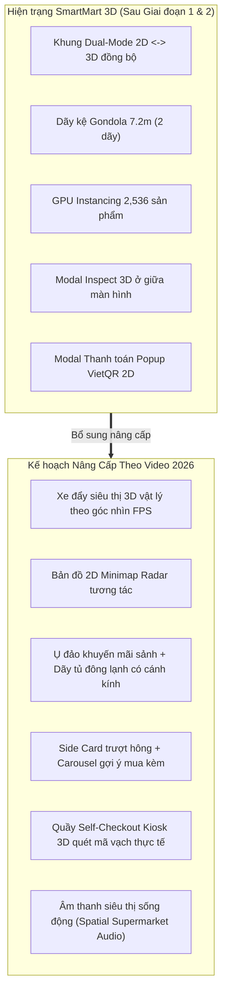

# ĐỀ ÁN NÂNG CẤP: SMARTMART 3D HYPERMARKET (NEXT-GEN 2026)
> **Nguồn cảm hứng quy chuẩn**: Video phân tích kỹ thuật *"3D HYPERMARKET WEBSITE 🛒 Websites in 2026 are INSANE 🤯 You don't just browse products. You WALK"*  
> **Tài liệu tham chiếu**: [WALMART_3D_SUPERMARKET_REPORT.md](file:///d:/DH13C1/Unknown_web/WALMART_3D_SUPERMARKET_REPORT.md)  
> **Người thực hiện**: Antigravity  
> **Ngày cập nhật**: 2026-11-07  

---

## 1. TỔNG QUAN PHÂN TÍCH VIDEO THAM CHIẾU (FRAME-BY-FRAME BREAKDOWN)

Video mô tả một bước nhảy vọt trong trải nghiệm thương mại điện tử không gian 3D (Spatial E-Commerce 2026): người dùng không chỉ "lướt xem ảnh sản phẩm", mà thực sự **bước đi, đẩy xe và mua sắm trong một đại siêu thị (Hypermarket)**.

```
+---------------------------------------------------------------------------------------------------+
|                         CÁC PHÂN CẢNH VÀ ĐẶC TRƯNG CHÍNH TỪ VIDEO                                 |
+-------------+----------------------------------+--------------------------------------------------+
| Timecode    | Phân cảnh & Tính năng            | Chi tiết kỹ thuật quan sát được                  |
+-------------+----------------------------------+--------------------------------------------------+
| 00:00-00:03 | Sảnh chính & Toàn cảnh siêu thị  | - Sàn gạch phản chiếu ánh sáng (Reflective tile) |
|             | (Central Concourse & Aisles)     | - Biển ngành hàng treo trên cao nhiều màu sắc    |
|             |                                  | - Ụ đảo khuyến mãi giữa lối đi (Promo Island)    |
|             |                                  | - Bản đồ Minimap Radar 2D ở góc dưới bên trái   |
+-------------+----------------------------------+--------------------------------------------------+
| 00:04-00:07 | Di chuyển trong lối đi & Xe đẩy  | - Xe đẩy siêu thị (Wire Trolley) bám theo camera |
|             | (First-Person Walking & Trolley) | - Dãy kệ cao 4-5 tầng xếp đầy ắp hàng hóa       |
|             |                                  | - Cuối lối đi có dãy tủ đông kính (Freezer)      |
+-------------+----------------------------------+--------------------------------------------------+
| 00:08-00:12 | Thao tác Nhặt hàng & Side Card   | - Bấm vào món hàng mở Panel trượt bên phải       |
|             | (Product Card & Drop to Trolley) | - Nút "Add to Trolley", giá tiền và ảnh HD       |
|             |                                  | - Mục gợi ý "Frequently Bought Together"         |
|             |                                  | - Sản phẩm bay trực tiếp vào lòng xe đẩy 3D      |
+-------------+----------------------------------+--------------------------------------------------+
| 00:13-00:14 | Chuyển đổi 2D theo ngành hàng    | - Click menu ngành hàng mở ngay lưới 2D          |
|             | (Seamless Category Grid 2D)      | - Thao tác thêm nhanh đồ uống, nước ngọt         |
+-------------+----------------------------------+--------------------------------------------------+
| 00:15-00:17 | Drawer giỏ hàng "Your Trolley"   | - Liệt kê danh sách, số lượng, nút Checkout      |
+-------------+----------------------------------+--------------------------------------------------+
| 00:18-00:26 | Quầy Self-Checkout Kiosk 3D      | - Xe đẩy tiến vào quầy tính tiền tự động         |
|             | (Kiosk quét mã & hoàn tất đơn)   | - Đèn LED xanh "AVAILABLE / CHECKOUT 04"         |
|             |                                  | - Máy quét mã vạch phẳng, túi giấy đóng hàng     |
|             |                                  | - Hiệu ứng quét từng món kèm âm thanh "bíp"     |
|             |                                  | - Xuất hóa đơn và thông báo thành công           |
+-------------+----------------------------------+--------------------------------------------------+
```

---

## 2. SO SÁNH HIỆN TRẠNG DỰ ÁN VỚI MẪU NÂNG CẤP TRONG VIDEO



---

## 3. LỘ TRÌNH 6 MODULE NÂNG CẤP TOÀN DIỆN CHO SMARTMART 3D

### MODULE 1: XE ĐẨY SIÊU THỊ 3D THEO GÓC NHÌN NGƯỜI DÙNG (FIRST-PERSON TROLLEY)

* **Mô tả**: Trong không gian 3D, camera người chơi luôn gắn kèm một mô hình xe đẩy hàng kim loại dạng lưới (`Wire Mesh Shopping Cart`) với thanh đẩy bọc đệm màu cam/xanh ở phía trước tầm nhìn.
* **Đặc tính kỹ thuật**:
  1. **Hiệu ứng chuyển động (Sway & Bobbing)**:
     - Khi người chơi bấm phím `WASD` di chuyển, xe đẩy có độ trễ quán tính nhẹ (`lerp` vị trí và xoay góc) và nhịp nhún nhẹ mô phỏng bước chân đi bộ.
  2. **Hiển thị sản phẩm thực tế trong lòng xe đẩy (In-Cart 3D Items)**:
     - Khi người dùng thêm sản phẩm vào giỏ, mô hình 3D thu nhỏ của sản phẩm đó sẽ xuất hiện và xếp vào trong giỏ xe đẩy!
     - Nếu có 1 hộp sữa Vinamilk và 2 lon Coca $\rightarrow$ trong xe đẩy thực sự nhìn thấy 1 hộp sữa và 2 lon nước ngọt!
  3. **Hiệu ứng vật lý thả đồ (Drop Animation)**:
     - Khi click "Thêm vào xe đẩy", sản phẩm từ kệ hoặc từ panel sẽ bay theo đường cong Parabol rơi vào giỏ xe kèm âm thanh *"clack"* kim loại vui tai.

---

### MODULE 2: BẢN ĐỒ MẶT BẰNG RADAR TƯƠNG TÁC (INTERACTIVE 2D MINIMAP)

* **Mô tả**: Bổ sung một bản đồ thu nhỏ ở góc dưới bên trái màn hình (`Bottom-Left HUD`).
* **Đặc tính kỹ thuật**:
  1. **Hiển thị trực quan**:
     - Mặt bằng siêu thị với các khu vực được mã hóa màu: Xanh dương (Đồ uống), Đỏ (Bánh kẹo & Mì gói), Xanh lá (Sản phẩm tươi), Tím (Gia vị), Vàng (Quầy thanh toán).
     - Chấm xanh biểu thị vị trí người chơi và hình nón quạt (FOV Cone) xoay theo góc quay chuột.
  2. **Dịch chuyển tức thời (Fast-Travel Teleport)**:
     - Người chơi có thể click chuột trực tiếp vào bất kỳ gian hàng nào trên Minimap để camera tự động lướt mượt mà (`smooth fly-to`) tới đứng ngay trước gian hàng đó mà không cần tự đi bộ.

---

### MODULE 3: KHÔNG GIAN ĐẠI SIÊU THỊ MỞ RỘNG (EXPANDED HYPERMARKET ENVIRONMENT)

* **Mô tả**: Nâng cấp từ 1 lối đi đơn lập thành một không gian đại siêu thị sầm uất giống video:
* **Các cấu trúc bổ sung**:
  1. **Ụ Đảo Khuyến Mại Giữa Sảnh (Promotional Island Bins / Dump Bins)**:
     - Đặt tại đầu sảnh chính: 2 bục đảo hình bát giác/chữ nhật nhiều tầng màu đỏ và vàng rực rỡ.
     - Biển báo lớn: `★ MUA 3 TÍNH TIỀN 2 ★`, `★ GIÁ SỐC CUỐI TUẦN ★`.
     - Xếp đầy ắp các gói snack, lon nước giải khát khuyến mãi.
  2. **Dãy Tủ Đông Đứng Cửa Kính (Glass-Door Freezer Aisles)**:
     - Đặt ở cuối sảnh (`Z = -5.0m`): Dãy tủ bảo quản lạnh với cánh cửa kính phản chiếu bóng loáng, bên trong gắn đèn LED trắng lạnh chiếu sáng các tầng kem, xúc xích và nước uống đá.
  3. **Hệ Thống Biển Treo Thả Trần Ngành Hàng (Overhead Department Banners)**:
     - Treo trên cao dọc các lối đi với màu sắc phân biệt rõ ràng:
       - `KHU NƯỚC GIẢI KHÁT & BIA` (Biển xanh dương)
       - `KHU BÁNH KẸO & SNACK` (Biển cam)
       - `KHU SỮA & SẢN PHẨM DINH DƯỠNG` (Biển xanh ngọc)
       - `QUẦY THU NGÂN TỰ ĐỘNG (SELF-CHECKOUT)` (Biển xanh lá cây dạ quang)

---

### MODULE 4: PANEL CHI TIẾT SẢN PHẨM TRƯỢT HÔNG & GỢI Ý MUA KÈM (SIDE-SLIDE INSPECTOR & CROSS-SELLING)

* **Mô tả**: Thay thế popup giữa màn hình bằng một panel trượt từ mép phải màn hình (`Slide-over Card`) tinh tế như trong video, không che khuất tầm nhìn 3D của người dùng.
* **Các thành phần trên Card**:
  1. Hình ảnh hoặc mô hình 3D xoay của sản phẩm.
  2. Tên tiếng Việt, đơn vị quy cách và giá niêm yết to rõ bằng VNĐ.
  3. Nút bấm `[+ Bỏ Vào Xe Đẩy]` kèm số lượng có thể chỉnh nhanh `[- 1 +]`.
  4. **Khu vực "Gợi ý mua kèm" (Frequently Bought Together)**:
     - Khi xem *Mì Hảo Hảo* $\rightarrow$ gợi ý thêm *Xúc xích tiệt trùng*, *Trứng gà*.
     - Khi xem *Cà phê G7* $\rightarrow$ gợi ý thêm *Sữa đặc Ông Thọ*, *Bánh quy*.
     - Giúp tăng giá trị đơn hàng trung bình (AOV - Average Order Value) mô phỏng chính xác hành vi mua sắm siêu thị.

---

### MODULE 5: QUẦY THU NGÂN TỰ ĐỘNG 3D MÔ PHỎNG THỰC TẾ (3D SELF-CHECKOUT KIOSK)

* **Mô tả**: Nâng cấp toàn diện quầy thanh toán từ modal 2D thành một **khu vực vật lý trong không gian 3D** đặt tại đầu siêu thị (`Z = 5.0m` gần cửa ra vào).
* **Quy trình tương tác**:
  1. Người chơi đẩy xe hàng tới quầy `CHECKOUT 04` (có đèn LED xanh chữ `AVAILABLE`).
  2. Khi đứng trong phạm vi quầy $\rightarrow$ Giao diện quầy thanh toán tự động kích hoạt trên màn hình cảm ứng của Kiosk.
  3. **Hiệu ứng quét mã vạch (Barcode Scanning Sequence)**:
     - Từng món hàng trong xe đẩy tự động lướt qua máy quét mã vạch phẳng trên mặt bàn.
     - Phát âm thanh *"bíp"* chuẩn quầy thu ngân siêu thị.
     - Màn hình POS hiển thị dòng sản phẩm và cộng dồn tiền tức thời.
     - Món hàng được đưa vào túi giấy `SMARTMART BAG` đặt bên cạnh.
  4. **Thanh toán VietQR động**:
     - Màn hình Kiosk hiển thị mã QR thanh toán ngân hàng Việt Nam.
     - Nút "Xác nhận đã thanh toán" $\rightarrow$ Kiosk in hóa đơn mô phỏng và hiển thị màn hình chúc mừng `"Túi hàng của bạn đã sẵn sàng! Cảm ơn bạn đã mua sắm!"`.

---

### MODULE 6: HỆ THỐNG ÂM THANH SIÊU THỊ SỐNG ĐỘNG (SPATIAL SUPERMARKET AUDIO)

* **Mô tả**: Thêm tầng âm thanh không gian (`Web Audio API / Howler.js`) giúp người dùng có cảm giác đắm chìm 100%:
  1. **Âm thanh nền (Ambient supermarket hum)**: Tiếng rì rầm nhẹ của tủ làm mát, tiếng nhạc êm dịu phong cách siêu thị.
  2. **Tiếng bánh xe đẩy (Cart rolling sound)**: Phát tiếng lăn bánh xe siêu thị trên sàn gạch khi người chơi bấm `WASD` di chuyển.
  3. **Tiếng nhặt hàng (Pick up & drop sound)**: Âm thanh *"ting"* nhẹ khi bỏ đồ vào xe.
  4. **Tiếng quét mã vạch (Scanner beep)**: Âm thanh *"tít"* đặc trưng khi quét sản phẩm tại quầy Self-checkout.

---

## 4. KẾ HOẠCH TÍCH HỢP VÀO CÁC GIAI ĐOẠN TIẾP THEO

Cập nhật lại lộ trình triển khai từ Giai đoạn 3 đến Giai đoạn 6 để hiện thực hóa toàn bộ các tính năng từ video:

```
+---------------------------------------------------------------------------------------------------+
|                           KẾ HOẠCH TRIỂN KHAI NÂNG CẤP CHI TIẾT                                    |
+---------------+--------------------------------------+--------------------------------------------+
| Giai đoạn     | Trọng tâm công việc theo Video 2026   | Deliverable dự kiến                        |
+---------------+--------------------------------------+--------------------------------------------+
| GIAI ĐOẠN 3   | Tương tác Nhặt hàng, Xe đẩy 3D theo  | - Xe đẩy wire trolley gắn theo camera      |
| (Tiếp theo)   | góc nhìn FPS & Side Panel mua kèm     | - Side-slide product card bên phải         |
|               |                                      | - Hiệu ứng đồ 3D rơi vào lòng xe đẩy       |
|               |                                      | - Mục gợi ý mua kèm (Cross-selling)        |
+---------------+--------------------------------------+--------------------------------------------+
| GIAI ĐOẠN 4   | Không gian đại siêu thị, Minimap 2D  | - Bản đồ Minimap Radar 2D ở góc màn hình   |
|               | & Ụ đảo khuyến mãi sảnh              | - Ụ đảo khuyến mãi sảnh (Promo bins)       |
|               |                                      | - Dãy tủ đông kính lạnh (Freezers)         |
|               |                                      | - Biển chỉ dẫn ngành hàng dạ quang         |
+---------------+--------------------------------------+--------------------------------------------+
| GIAI ĐOẠN 5   | Quầy Self-Checkout Kiosk 3D vật lý   | - Dựng trạm Kiosk Check-out 3D hoàn chỉnh  |
|               | & Quét mã vạch tự động VietQR        | - Animation quét từng món qua máy quét     |
|               |                                      | - Âm thanh bíp quét mã vạch & in biên lai  |
|               |                                      | - Sinh mã VietQR thanh toán tự động        |
+---------------+--------------------------------------+--------------------------------------------+
| GIAI ĐOẠN 6   | Tối ưu Mobile, Âm thanh không gian   | - Hỗ trợ Joystick cảm ứng điện thoại       |
|               | & Đóng gói triển khai Production     | - Âm thanh tiếng bánh xe lăn & nhạc nền    |
|               |                                      | - Deploy Vercel / Cloudflare Pages         |
+---------------+--------------------------------------+--------------------------------------------+
```

---

## 5. KẾT LUẬN

Video quy chiếu cho thấy tương lai của mua sắm trực tuyến năm 2026 chính xác là mô hình mà chúng ta đang xây dựng với **SmartMart 3D**. Việc bổ sung **Xe đẩy 3D theo người**, **Bản đồ Minimap Radar**, **Side-slide card mua kèm** và **Quầy Self-Checkout Kiosk 3D** sẽ đưa dự án lên tiêu chuẩn hàng đầu thế giới về Web 3D E-Commerce!

