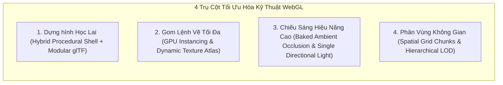

# BẢN KẾ HOẠCH TRIỂN KHAI PHÁT TRIỂN TOÀN DIỆN MÔ HÌNH ĐẠI SIÊU THỊ SMARTMART 3D
## (DỰA TRÊN BỘ ẢNH THIẾT KẾ MẪU SIÊU THỊ HYPERMARKET CỦA BY OMID TẠI `D:\Docker\demo`)

> **Tài liệu quy chiếu**:
> - Thư mục tài nguyên đối chiếu: `D:\Docker\demo`
> - Bộ 6 ảnh kết xuất 3D chi tiết: `01-overview.webp`, `02-entrance.webp`, `03-produce.webp`, `04-grocery.webp`, `05-apparel.webp`, `06-checkout.webp`
> - Bản phân tích sơ bộ: `D:\Docker\demo\SMARTMART_3D_PLAN.md`
> - Dự án nền tảng: **SmartMart 3D** (React Three Fiber, Three.js, Zustand, TailwindCSS, Vite)
> - Ngày ban hành kế hoạch: **2026-11-07**

---

## 1. PHÂN TÍCH CHUYÊN SÂU 6 BỨC ẢNH KẾT XUẤT 3D MẪU (`By Omid`)

Bộ ảnh mẫu của tác giả Omid thể hiện không gian một đại siêu thị tiêu chuẩn quốc tế (phong cách Walmart / Target) với bố cục không gian, tỷ lệ thị giác và hệ thống chiếu sáng đạt chuẩn thương mại cao cấp.

```
+---------------------------------------------------------------------------------------------+
|                                    SƠ ĐỒ TỔNG MẶT BẰNG 3D                                   |
|                                                                                             |
|   [TỦ ĐÔNG / DAIRY & FROZEN]      [BÁNH MÌ TƯƠI / BAKERY & DELI]    [KHO HÀNG / WAREHOUSE]  |
|   +-------------------------------------------------------------------------------------+   |
|   | KỆ A17 | KỆ A13 | KỆ A09 | KỆ A05 | KỆ A01 |          | BÀN RAU CỦ 01 | BÀN RAU CỦ 02 | |
|   |        |        |        |        |        |  TRỤC    |               |               | |
|   | KỆ A18 | KỆ A14 | KỆ A10 | KỆ A06 | KỆ A02 |  CHÍNH   | BÀN RAU CỦ 03 | BÀN RAU CỦ 04 | |
|   |-----------------+--------+-----------------|  (4m)    |---------------+---------------| |
|   |        LỐI CẮT NGANG THÔNG THOÁNG (CROSS-AISLE)       | BÀN RAU CỦ 05 | BÀN RAU CỦ 06 | |
|   |-----------------+--------+-----------------|          +-------------------------------+ |
|   | KỆ A19 | KỆ A15 | KỆ A11 | KỆ A07 | KỆ A03 |          |                               | |
|   |        |        |        |        |        |          |   KHU THỜI TRANG & GIÀY DÉP   | |
|   | KỆ A20 | KỆ A16 | KỆ A12 | KỆ A08 | KỆ A04 |          |  (SÀN GỖ BIRCH WOOD - APPAREL)| |
|   +--------------------------------------------+          |   [GIÁ TREO]    [BÀN PHỤ KIỆN]| |
|                                                           +-------------------------------+ |
|   ===================== SẢNH DI CHUYỂN CHÍNH (MAIN CONCOURSE) ===========================   |
|                                                                                             |
|   [XE ĐẨY CART CORRAL]    [DÃY KIOSK SELF-CHECKOUT 01 -> 08]    [CỬA RA VÀO / ENTRANCE]     |
+---------------------------------------------------------------------------------------------+
```

### 1.1. Chi tiết từng phân cảnh quan sát từ bộ ảnh

| Tệp ảnh | Phân cảnh quan sát | Đặc trưng cốt lõi cần hiện thực hóa cho SmartMart 3D |
| :--- | :--- | :--- |
| **01-overview.webp** | **Toàn cảnh Mặt bằng Siêu thị (Bird's Eye)** | - Không gian bao quát tỷ lệ hình chữ nhật lớn $40\text{m} \times 54\text{m}$.<br>- Phân khu tương phản mạnh mẽ: Khu may mặc sàn gỗ ấm cúng ở trung tâm; Khu nông sản tươi sống bên phải; 12–16 dãy kệ tạp hóa song song có lối cắt ngang; Dãy tủ đông lạnh & thực phẩm chế biến viền quanh tường sau.<br>- Dãy quầy tự thanh toán trải dài phía trước kèm chuồng tập kết xe đẩy. |
| **02-entrance.webp** | **Sảnh đón tiếp & Tầm nhìn Trục chính (Entrance Vista)** | - Trục đường chính (Main concourse) rộng $4\text{m}$ đón khách ngay từ cửa vào, tầm nhìn sâu không bị chắn bởi các biển quảng cáo vô lý.<br>- Hệ trần công nghiệp (Open-truss industrial ceiling) với dàn dầm thép mạ kẽm, tôn sóng mái xám nhạt, ống thông gió điều hòa tròn (HVAC ducts) và các máng đèn tuýp LED thả trần dài.<br>- Cột bê tông vuông màu trắng sữa $0.5\text{m} \times 0.5\text{m}$ có ốp chân đế chống va đập màu đen cao $0.15\text{m}$. |
| **03-produce.webp** | **Khu Rau Củ Quả Tươi Sống (Fresh Produce)** | - Bàn trưng bày bằng gỗ nan tối màu (Dark Wood Slats) chân thép hộp, có 2 tầng (tầng trên nghiêng $8^\circ$ chia ô mica, tầng dưới phẳng để trữ rổ hàng).<br>- Sản phẩm tươi chia nhóm rõ ràng: ớt chuông, dưa chuột, táo, bơ, chanh...<br>- Bảng giá viền trắng chân kẹp nhỏ gọn gắn ngay mép trước mỗi ô.<br>- Tranh tường đồ họa khổ lớn *"Fresh picks"* tông xanh đậm tôn vinh độ tươi ngon. |
| **04-grocery.webp** | **Lối đi Dãy Kệ Tạp Hóa (Grocery Aisle Walkway)** | - Dãy kệ Gondola chuẩn hóa: vách lưng tôn đục lỗ (pegboard), các tầng đợt khay kim loại trắng có ray nẹp giá (price rail) liên tục.<br>- Chân đế kệ (kickplate) màu xanh nhận diện thương hiệu.<br>- Đầu hồi có biển định danh mã dãy (A01, A05, A09...) và màn hình LCD kỹ thuật số treo trần hiển thị mặt hàng tâm điểm.<br>- Hàng hóa xếp phẳng đáy, không xuyên vách ngăn hay mép tầng kệ. |
| **05-apparel.webp** | **Đảo Thời Trang & Phụ Kiện (Apparel & Accessories)** | - Sàn gỗ tự nhiên (Birch wood parquet) phân biệt rõ nét với sàn bê tông công nghiệp.<br>- Trần thạch cao hạ bậc với hệ thống đèn âm trần hiện đại.<br>- Giá treo quần áo chữ U mỏng nhẹ (Everyday Clothing), bàn trưng bày giày thể thao và nón mũ 2 tầng (Accessories). Chiều cao dưới $1.4\text{m}$ để giữ trọn tầm nhìn xuyên suốt sang các phân khu khác. |
| **06-checkout.webp** | **Dãy Kiosk Tự Thanh Toán (Self-Checkout Bank)** | - Cụm Kiosk thanh toán màu trắng bo góc, mặt bàn xám đậm chống xước, máy quét laser phẳng, màn hình POS cảm ứng ngửa nghiêng và cột biển báo cao vừa đủ *"Self checkout"*.<br>- Hàng xe đẩy kim loại lồng vào nhau gọn gàng ở khu chuồng xe đẩy (Cart Corral) bên cạnh. |

---

## 2. PHÂN TÍCH & GIẢI THÍCH LỰA CHỌN CÔNG NGHỆ TỐI ƯU NHẤT

Mục tiêu cốt lõi: **Đạt độ chân thực và quy mô tương đương mô hình của Omid nhưng chạy mượt mà 60 FPS trên WebGL/trình duyệt, tải tức thì (< 3s) và tiêu thụ ít bộ nhớ (< 250MB VRAM).**



### 2.1. Dựng hình học: Kiến trúc Lai (Hybrid Procedural Shell + Modular glTF)
- **Vấn đề nếu tải toàn bộ file 3D GLB lớn**: Nếu xuất cả siêu thị $40\text{m} \times 54\text{m}$ thành một file `.glb` duy nhất, dung lượng sẽ lên tới 60MB - 120MB, khiến thời gian nạp ban đầu qua mạng Internet kéo dài hàng chục giây, đồng thời làm tràn bộ nhớ trình duyệt điện thoại.
- **Giải pháp tối ưu lựa chọn**:
  1. **Vỏ kiến trúc bằng Procedural Three.js Mesh**:
     - Sàn, tường bao, cột chịu lực, hệ dàn dầm thép tam giác (Trusses) và ống thông gió (HVAC ducts) được tạo bằng thuật toán mã nguồn Three.js.
     - Sử dụng `BufferGeometryUtils.mergeGeometries` để gộp toàn bộ các thanh giằng thép cùng chung vật liệu kim loại thành **1 Draw Call duy nhất**, tiêu tốn **0 KB** dung lượng tải mạng.
  2. **Kệ Gondola và Bàn kệ theo mô-đun tham số (Parametric Modular Fixtures)**:
     - Tạo 1 mô-đun kệ mẫu ($1.2\text{m} \times 0.5\text{m} \times 1.85\text{m}$), sau đó nhân rộng thành các dãy kệ thông qua ma trận biến đổi.
  3. **Hàng hóa và Vật thể hữu cơ đặc thù**:
     - Chỉ những vật thể có hình dáng uốn lượn đặc thù (trang phục, giày dép, mũ, rau củ quả, xe đẩy) mới được dựng Low-Poly trong Blender và nén bằng **glTF-Transform (Draco + Meshopt + KTX2/Basis Universal)**, giảm kích thước tệp tải về tới 85%.

### 2.2. Quản lý Hiệu năng: GPU Instancing & Texture Atlas
- **Khắc phục nghẽn cổ chai Draw Calls (Draw Call Bottleneck)**:
  - Một đại siêu thị có từ 10,000 đến 30,000 vật thể hàng hóa trên các tầng kệ. Nếu mỗi món là một Mesh riêng, trình duyệt sẽ sập hoàn toàn vì nghẽn CPU-GPU bus.
  - Sử dụng **`THREE.InstancedMesh`**: Hàng ngàn hộp ngũ cốc, lon nước ngọt hay quả ớt chuông chia sẻ chung một Geometry và Material, được phân vị bằng ma trận $4 \times 4$ trong bộ nhớ GPU. Toàn bộ 5,000 lon nước chỉ tốn **1 Draw Call**.
- **Dynamic Texture Atlas**:
  - Gộp toàn bộ bao bì sản phẩm, bảng giá và biển chỉ dẫn vào **3 Texture Atlas kích thước $2048 \times 2048$**.
  - Dùng thuộc tính `instancedBufferAttribute` để truyền tọa độ UV Offset cho từng instance, cho phép nhiều loại sản phẩm khác nhau vẽ chung trong cùng một lệnh render.

### 2.3. Giải pháp Chiếu sáng & Đổ bóng (Lighting & Shading Strategy)
- **Loại bỏ bóng động đa nguồn**:
  - Việc bật `castShadow = true` cho hàng chục ngọn đèn trần sẽ làm GPU phải tính toán shadow map lặp đi lặp lại hàng chục lần mỗi khung hình.
- **Phương án chiếu sáng tối ưu**:
  1. **1 Directional Light chính** mô phỏng ánh sáng tán xạ từ mái, độ phân giải bóng mềm `shadow-mapSize={[2048, 2048]}` sử dụng thuật toán `PCFSoftShadowMap`.
  2. **Bóng tiếp xúc tĩnh (Contact Shadows / Baked AO)**: Tạo lớp bóng mờ tiếp xúc nhẹ dưới chân đế kệ hàng, chân bàn rau củ và trụ Kiosk, giúp loại bỏ hiện tượng vật thể "bay lơ lửng" trên sàn gạch.
  3. **Vật liệu phát sáng (Emissive Materials)**: Các máng đèn tuýp LED trên trần nhà, màn hình cảm ứng POS và dải đèn hắt kệ sử dụng vật liệu phát quang giả lập ánh sáng trực quan mà không tiêu tốn chi phí tính toán nguồn sáng thực.

### 2.4. Phân vùng Không gian & Giảm chi tiết (Spatial Chunks & LOD)
- **Lưới phân vùng không gian (Spatial Grid Chunks)**:
  - Chia toàn bộ mặt bằng siêu thị thành các ô lưới kích thước $10\text{m} \times 10\text{m}$.
  - Chỉ tính toán raycast tương tác hover/click cho các kệ hàng nằm trong ô lưới của người chơi.
- **Phân cấp chi tiết (Level of Detail - LOD 3 cấp độ)**:
  - *LOD 0 (Khoảng cách < 3m)*: Hiển thị đầy đủ nhãn giá, bo góc, chi tiết tem nhãn và chữ rõ nét.
  - *LOD 1 (Khoảng cách 3m – 12m)*: Dùng khối hình học đơn giản hóa (Box/Cylinder), texture bao bì nén nhẹ.
  - *LOD 2 (Khoảng cách > 12m)*: Khối màu đại diện đơn sắc hoặc gộp thành dải màu liên tục, tắt hoàn toàn raycast.

### 2.5. Kiến Trúc Mặt Bằng & Sơ Đồ Trưng Bày Hướng Dữ Liệu (Data-Driven Layout & Planogram Engine)
*Tham chiếu cốt lõi: Mục 4 tài liệu `D:\Docker\demo\SMARTMART_3D_PLAN.md`*

Để sau này **dễ dàng thay đổi, hoán đổi hoặc tái cấu trúc vị trí các khu vực bán hàng** (VD: dời khu Rau củ sang vị trí khác, mở rộng hoặc thu hẹp dãy kệ, hoán đổi quầy Thời trang với Đồ khô, điều chỉnh sản phẩm trưng bày theo mùa/khuyến mãi) mà **KHÔNG CẦN VIẾT LẠI MÃ NGUỒN 3D**, toàn bộ hệ thống được phân rã thành **3 tầng dữ liệu tách biệt hoàn toàn**:

```
+-----------------------------------------------------------------------------------------+
|                    KIẾN TRÚC 3 TẦNG DỮ LIỆU ĐỘC LẬP (3-TIER DATA ARCHITECTURE)          |
+-----------------------------------------------------------------------------------------+
|                                                                                         |
|  [TẦNG 1: DANH MỤC SẢN PHẨM]  (Product Catalog: ID, Tên, Giá, Kích thước bao bì, Texture)|
|                         │                                                               |
|                         ▼                                                               |
|  [TẦNG 3: SƠ ĐỒ TRƯNG BÀY]    (Planogram: Kệ nào -> Ngăn nào -> Bày món gì -> Số lượng)  |
|                         ▲                                                               |
|                         │                                                               |
|  [TẦNG 2: MẶT BẰNG & PHÂN KHU] (Store Layout: Zones, Tọa độ Fixture [X, Y, Z], Hướng quay)|
|                         │                                                               |
|                         ▼                                                               |
|  ┌──────────────────────┴────────────────────────────────────────────────────────────┐  |
|  │ CÁC HỆ THỐNG TỰ ĐỘNG SINH (AUTO-GENERATED):                                       │  |
|  │  1. Mô hình 3D Scene (InstancedMesh, Bàn ghế, Kệ hàng tự dựng theo tọa độ)        │  |
|  │  2. Bản đồ chướng ngại vật A* (Obstacles, Grid collision tự cập nhật)             │  |
|  │  3. Bản đồ Radar 2D / Minimap SVG (Tự vẽ phân khu và các icon dịch chuyển)        │  |
|  │  4. Tọa độ Dẫn đường Sản phẩm (Tự tính vị trí đứng approach trước mặt sản phẩm)   │  |
|  └───────────────────────────────────────────────────────────────────────────────────┘  |
+-----------------------------------------------------------------------------------------+
```

1. **Tầng 1: Danh mục Hàng hóa thuần túy (Product Catalog)**:
   - Tệp quy định: `src/data/mockProducts.ts` (hoặc nạp từ Backend API / JSON).
   - Chỉ lưu trữ thuộc tính sản phẩm: `id`, `name`, `price`, `category`, `dimensions` $[w, h, d]$, `textureId`, `barcode`, `weight`.
   - **Tuyệt đối không lưu tọa độ không gian cứng** trong danh mục để sản phẩm có thể đặt ở bất kỳ kệ nào.

2. **Tầng 2: Mặt bằng Phân khu & Bố trí Nội thất (Store Layout & Fixture Map)**:
   - Tệp quy định: `src/data/storeLayout.ts` và `src/data/storeZones.ts`.
   - Quản lý danh sách các vùng bán hàng (`zones`):
     - `zone_grocery`: Tọa độ $[X, Z]$, danh sách các dãy kệ Gondola (`xPositions`, `lengths`, `crossAisleGap`).
     - `zone_produce`: Tọa độ bàn rau củ nan gỗ (`produceTables: [{ id, x, z, rotationY }]`).
     - `zone_apparel`: Tọa độ sàn gỗ Birch, vị trí các giá treo quần áo và bàn phụ kiện.
     - `zone_checkout`: Tọa độ dãy Kiosk tự thanh toán và chuồng xe đẩy.
   - **Cơ chế tự động sinh**:
     - `STORE_LAYOUT.obstacles` tự động duyệt qua tất cả Fixture trong các Zone để tạo vật cản A\* mà không cần ai khai báo thủ công.
     - `FloorPlanMap.tsx` tự động lấy danh sách Zone để vẽ các mảng màu trên bản đồ 2D.

3. **Tầng 3: Sơ đồ Trưng bày Hàng hóa trên Kệ (Planogram Engine)**:
   - Tệp quy định: `src/data/storePlanogram.ts`.
   - Định nghĩa trực quan theo từng ô kệ:
     ```ts
     {
       fixtureId: "gondola-aisle-02",
       bayIndex: 1, // Khoang số 1
       tierIndex: 2, // Tầng số 2
       side: "left", // Mặt trái kệ
       productId: "prod-milk-vinamilk",
       arrangement: { cols: 8, rows: 4, stack: 1 }
     }
     ```
   - Hàm `generateBlockMatrices` trong `stockMatrices.ts` đọc cấu hình này, kết hợp kích thước bao bì ở Tầng 1 và kích thước khoang kệ ở Tầng 2 để tự động tính toán:
     - Tọa độ 3D của hàng hóa đặt khít trên khay kệ, tự trừ đệm an toàn không xuyên vách.
     - Tự động sinh `shelfLocation.worldPos` cho chức năng tìm kiếm và dẫn đường A\*.

**Lợi ích trực tiếp**:
Khi cửa hàng muốn tái cấu trúc mặt bằng (VD: đổi khu rau củ sang góc khác, mở rộng lối đi, dời quầy thanh toán, thêm dãy kệ mới), **chỉ cần sửa dữ liệu trong `storeZones.ts` và `storePlanogram.ts`**. Không gian 3D, Bản đồ 2D và Thuật toán Dẫn đường sẽ tự động đồng bộ tức thì 100%!

---

## 3. THÔNG SỐ QUY CHUẨN THIẾT KẾ KHÔNG GIAN (DESIGN STANDARDS)

Để bảo đảm tính nhất quán và chuẩn xác tỷ lệ kiến trúc như bộ ảnh Omid:

| Hạng mục kiến trúc | Kích thước thiết kế | Tọa độ / Quy cách kỹ thuật |
| :--- | :--- | :--- |
| **Quy ước tỷ lệ** | $1\text{ unit} = 1\text{ mét}$ | Thống nhất trên toàn bộ hệ tọa độ Three.js |
| **Tổng diện tích sàn** | $40\text{m} \times 54\text{m}$ ($2,160\text{ m}^2$) | Tọa độ $X \in [-20, 20]$, $Z \in [-27, 27]$ |
| **Chiều cao trần** | $5.8\text{m}$ | Chiều cao treo đèn tuýp: $4.8\text{m}$ |
| **Hệ thống cột chịu lực** | $0.5\text{m} \times 0.5\text{m} \times 5.8\text{m}$ | Lưới bước cột cách nhau $10\text{m}$, chân đế ốp đen cao $0.15\text{m}$ |
| **Dãy kệ Gondola tạp hóa** | Cao $1.85\text{m}$, sâu $0.96\text{m}$, dài $7.2\text{m}$ | Gồm 6 khoang $1.2\text{m}$, 4 tầng đợt khay, độ dày vách $0.05\text{m}$ |
| **Khoảng cách lối đi kệ** | $2.2\text{m}$ | Khoảng cách giữa 2 mép kệ đối diện |
| **Trục di chuyển chính (Concourse)** | Rộng $4.0\text{m}$ | Trục dọc nối từ cửa vào xuyên suốt siêu thị |
| **Lối cắt ngang (Cross-Aisle)** | Rộng $2.4\text{m}$ | Cắt ngang giữa các dãy kệ để chuyển lối |
| **Khu thời trang may mặc** | $14\text{m} \times 16\text{m}$ | Sàn gỗ sồi tự nhiên Birch Wood, chiều cao giá kệ $< 1.4\text{m}$ |
| **Bàn rau củ tươi sống** | $2.2\text{m} \times 1.2\text{m} \times 0.85\text{m}$ | Gỗ nan tối màu, mặt nghiêng $8^\circ$, chia 4–6 ô nông sản |
| **Trạm Kiosk thanh toán** | $1.8\text{m} \times 0.85\text{m} \times 1.45\text{m}$ | Bàn đặt hàng trái + POS Kiosk giữa + Bàn đóng túi phải |
| **Tầm mắt người dùng (FPS)** | $1.65\text{m}$ | Góc nhìn tự nhiên tương thích cả Desktop và Mobile |

---

## 4. KẾ HOẠCH TRIỂN KHAI THEO 6 GIAI ĐOẠN (IMPLEMENTATION ROADMAP)

```
+-------------------------------------------------------------------------------------------------------+
|                                    LỘ TRÌNH 6 GIAI ĐOẠN NÂNG CẤP                                      |
+-----------+----------------------------------------------+--------------------+-----------------------+
| Giai đoạn | Trọng tâm công việc                          | Thời lượng ước tính| Deliverables bàn giao |
+-----------+----------------------------------------------+--------------------+-----------------------+
| PHASE 1   | Khung sàn 40x54m, Trần Dầm Thép & Sảnh Vào   | 2 - 3 ngày         | Vỏ kiến trúc chuẩn    |
| PHASE 2   | Dãy Kệ Gondola Chuẩn Hóa & Khu Tạp Hóa       | 3 - 4 ngày         | Gian hàng tạp hóa lớn |
| PHASE 3   | Phân Khu Nông Sản Rau Củ Tươi Sống (Produce) | 2 - 3 ngày         | Bàn rau củ chia ô     |
| PHASE 4   | Đảo Thời Trang May Mặc Sàn Gỗ (Apparel)      | 2 - 3 ngày         | Khu may mặc thanh lịch|
| PHASE 5   | Cụm Kiosk Tự Thanh Toán & Chuồng Xe Đẩy      | 2 ngày             | Cụm thu ngân 6 trạm   |
| PHASE 6   | Texture Atlas, Tối ưu LOD & Chụp 6 Ảnh Mẫu   | 2 - 3 ngày         | Nghiệm thu 60 FPS     |
+-----------+----------------------------------------------+--------------------+-----------------------+
```

---

### GIAI ĐOẠN 1: CHUẨN HÓA MẶT BẰNG LƯỚI & KHUNG NHÀ CÔNG NGHIỆP
*Tham chiếu: Ảnh `01-overview.webp` và `02-entrance.webp`*

#### 1. Mục tiêu công việc
Mở rộng mặt bằng không gian siêu thị lên quy mô đại siêu thị $40\text{m} \times 54\text{m}$, xây dựng hệ khung vì kèo thép công nghiệp, đường ống thông gió và sảnh đón tiếp rộng mở.

#### 2. Các tệp mã nguồn triển khai
- Sửa đổi: `src/data/storeLayout.ts`
- Tạo mới: `src/components/3d/SupermarketStructure.tsx`
- Sửa đổi: `src/components/3d/Scene3D.tsx`

#### 3. Nhiệm vụ kỹ thuật chi tiết
1. **Cập nhật `storeLayout.ts`**:
   - `STORE_LAYOUT.minX = -20`, `maxX = 20`, `minZ = -27`, `maxZ = 27`.
   - Bố trí lưới cột chịu lực: 12 cột vuông phân bố tại các giao điểm tọa độ $X = \pm 10\text{m}$, $Z \in [-18, -6, 6, 18]\text{m}$.
2. **Xây dựng `SupermarketStructure.tsx`**:
   - **Mặt sàn bê tông mài**: Kích thước $40\text{m} \times 54\text{m}$, màu `#e2e8f0`, `roughness: 0.18`, có vạch sơn phân làn màu trắng ngà.
   - **Hệ dầm thép Truss công nghiệp**: Tạo hệ thống 9 dầm thép tam giác nhịp $40\text{m}$ chạy ngang mái ở cao độ $y = 5.2\text{m} \to 5.8\text{m}$.
   - **Hệ thống ống thông gió HVAC**: 2 ống tròn đường kính $0.65\text{m}$ màu bạc mạ kẽm chạy dọc suốt chiều dài siêu thị tại cao độ $y = 4.9\text{m}$.
   - **Dãy đèn tuýp LED treo trần**: 8 hàng đèn tuýp LED đôi thả trần thẳng hàng với các lối đi chính.
   - **Tường bao quanh siêu thị**: Tường thạch cao công nghiệp màu xám sáng `#f1f5f9`, chân tường ốp len bảo vệ màu xám đậm.
3. **Cửa vào & Sảnh đón tiếp (Entrance Vista)**:
   - Thiết lập vị trí camera mặc định tại $x = 0, y = 1.65, z = 23$, hướng nhìn thẳng vào trục sảnh chính rộng $4\text{m}$, mở ra góc nhìn đại cảnh giống ảnh `02-entrance.webp`.

#### 4. Tiêu chí nghiệm thu (Acceptance Criteria)
- Đứng ở cửa vào nhìn thông thoáng, thấy rõ hệ trần dầm thép và các phân khu chức năng.
- Góc nhìn từ trên cao thể hiện trọn vẹn mặt bằng hình chữ nhật cân đối chuẩn xác.

---

### GIAI ĐOẠN 2: DÃY KỆ GONDOLA CHUẨN HÓA & MỞ RỘNG TẠP HÓA
*Tham chiếu: Ảnh `04-grocery.webp`*

#### 1. Mục tiêu công việc
Nâng cấp toàn diện hệ thống kệ Gondola tạp hóa thành 8–12 dãy kệ quy chuẩn cao tầng, bổ sung dải nhãn giá liên tục và loại bỏ triệt để lỗi xuyên thanh chắn.

#### 2. Các tệp mã nguồn triển khai
- Sửa đổi: `src/components/3d/AisleGondola.tsx`
- Sửa đổi: `src/utils/stockMatrices.ts`
- Sửa đổi: `src/components/3d/InstancedStock.tsx`

#### 3. Nhiệm vụ kỹ thuật chi tiết
1. **Chuẩn hóa kích thước khung kệ Gondola**:
   - Chiều cao kệ: $1.85\text{m}$, chiều sâu: $0.96\text{m}$, chiều dài: $7.2\text{m}$ (6 khoang $\times 1.2\text{m}$).
   - Vách lưng tôn đục lỗ màu trắng xám `#e2e8f0` với hàng ngàn lỗ li ti tạo chiều sâu vật liệu.
   - Chân đế kệ (Kickplate) màu xanh SmartMart cao $0.18\text{m}$.
   - Khay kệ kim loại 4 tầng ($y = [0.45, 0.90, 1.35, 1.80]\text{m}$) có dải nẹp ray bảng giá màu trắng sữa liên tục ở mép khay.
2. **Quy tắc toán học xếp hàng không xuyên vách (`stockMatrices.ts`)**:
   - Khoang sử dụng thực tế: $\text{BayWidth} = 1.2\text{m} - 2 \times 0.045\text{m} (\text{dividerPadding}) = 1.11\text{m}$.
   - Đáy sản phẩm đặt chính xác trên mặt khay kệ: $\text{shelfTopY} = \text{tierY} + 0.0175\text{m}$.
   - Tính toán số cột hàng theo trục $Z$ và hàng sâu theo trục $X$ để sản phẩm nằm gọn gàng trong khoang, mép ngoài cách ray giá tối thiểu $2\text{cm}$.
3. **Mở rộng 8–12 dãy kệ tạp hóa có lối cắt ngang (Cross-Aisle)**:
   - Bố trí các dãy kệ tại tọa độ trục $X = [-16, -13, -10, -7, -4]\text{m}$.
   - Mỗi dãy được ngắt quãng ở giữa ($Z \in [-1.2, 1.2]\text{m}$) tạo lối đi cắt ngang rộng $2.4\text{m}$, cho phép khách hàng chuyển làn linh hoạt.
4. **Biển định danh đầu kệ & Màn hình LCD kỹ thuật số treo trần**:
   - Biển đầu kệ: Khối hộp màu xanh gắn mã dãy nổi bật (A01, A02, A03, A04, A05...).
   - Màn hình LCD kỹ thuật số treo trên trần đầu lối đi thể hiện thông tin: *"SmartMart * Grocery / Rolled Oats / 36.000 đ / Tap display to inspect"*.

#### 4. Tiêu chí nghiệm thu (Acceptance Criteria)
- Đứng trong lối đi tạp hóa quan sát hai bên kệ đạt tỷ lệ và độ ngăn nắp chuẩn xác như ảnh `04-grocery.webp`.
- Sản phẩm không chạm thanh ngăn dọc, bảng giá gắn chuẩn mép tầng kệ.

---

### GIAI ĐOẠN 3: PHÂN KHU RAU CỦ QUẢ TƯƠI SỐNG (FRESH PRODUCE)
*Tham chiếu: Ảnh `03-produce.webp`*

#### 1. Mục tiêu công việc
Hiện thực hóa khu vực nông sản thực phẩm tươi sống với các bàn trưng bày nan gỗ thấp, vách chia ô mica và hệ thống tranh tường đồ họa "Fresh picks".

#### 2. Các tệp mã nguồn triển khai
- Tạo mới: `src/components/3d/ProduceSection.tsx`
- Tạo mới: `src/data/produceProducts.ts`
- Sửa đổi: `src/data/storeLayout.ts`

#### 3. Nhiệm vụ kỹ thuật chi tiết
1. **Thiết kế component Bàn trưng bày rau củ (`ProduceDisplayTable`)**:
   - Kích thước bàn: Rộng $2.2\text{m}$, sâu $1.2\text{m}$, cao $0.85\text{m}$.
   - Khung chân bằng thép hộp sơn tĩnh điện màu đen mờ `#1e293b`.
   - Thân bàn ốp các nan gỗ sẫm màu (Dark Wood Slats `#451a03`) có khe hở thoát khí mô phỏng chuẩn bàn siêu thị.
   - Mặt bàn nghiêng $8^\circ$ hướng về phía khách đi bộ, chia thành 4–6 ngăn bằng vách mica trong suốt.
   - Tầng kệ phẳng bên dưới chân bàn để chứa các sọt nhựa/thùng gỗ trữ hàng.
2. **Mô hình hóa nhóm nông sản tươi sống 3D**:
   - Ớt chuông đỏ (Red Bell Pepper), Dưa chuột xanh (Cucumber), Táo đỏ (Fresh Apple), Chanh vàng (Lemon), Trái bơ sáp (Avocado), Cà chua bi (Cherry Tomato).
   - Sử dụng GPU Instancing cho từng loại quả xếp đầy trong từng ô ngăn.
   - Mỗi ô có bảng giá chân quỳ màu trắng chữ đen thể hiện tên sản phẩm, đơn vị (kg/gói) và giá tiền VNĐ.
3. **Tranh tường đồ họa & Biển ngành hàng "Fresh Picks"**:
   - Dán 3 pano tranh tường khổ lớn $3.6\text{m} \times 1.8\text{m}$ nền xanh lục sẫm trên bức tường bên phải với đồ họa quả táo, quả chanh và trái bơ.
   - Biển treo tường dài màu xanh dương: *"RAU CỦ QUẢ TƯƠI SỐNG / FRESH PRODUCE"*.

#### 4. Tiêu chí nghiệm thu (Acceptance Criteria)
- Bố cục cụm bàn rau củ tạo cảm giác thoáng đãng, chiều cao thấp hơn kệ tạp hóa để giữ tầm nhìn mở.
- Tái hiện trọn vẹn màu sắc tươi mới và phong cách thiết kế của ảnh `03-produce.webp`.

---

### GIAI ĐOẠN 4: ĐẢO THỜI TRANG & MAY MẶC SÀN GỖ (APPAREL & ACCESSORIES)
*Tham chiếu: Ảnh `05-apparel.webp`*

#### 1. Mục tiêu công việc
Dựng khu trung tâm thời trang may mặc sang trọng với sàn gỗ tự nhiên, trần hạ bậc thạch cao, các giá treo quần áo chữ U thanh mảnh và bàn phụ kiện giày dép.

#### 2. Các tệp mã nguồn triển khai
- Tạo mới: `src/components/3d/ApparelSection.tsx`
- Sửa đổi: `src/components/3d/SupermarketStructure.tsx`
- Sửa đổi: `src/data/mockProducts.ts`

#### 3. Nhiệm vụ kỹ thuật chi tiết
1. **Sàn gỗ Birch Wood & Trần hạ bậc tổ ong**:
   - Lát sàn gỗ ghép tấm sáng màu (Birch Wood Parquet `#d97706` pha vàng kem) diện tích $14\text{m} \times 16\text{m}$ tại trung tâm siêu thị ($X \in [3, 17]\text{m}$, $Z \in [-8, 8]\text{m}$).
   - Phía trên đảo thời trang: Trần thạch cao hạ xuống cao độ $y = 4.5\text{m}$ với các tấm trần thả $0.6\text{m} \times 1.2\text{m}$ và đèn tuýp âm trần tạo không gian ấm cúng.
2. **Giá treo quần áo chữ U (`ClothingRack`)**:
   - Khung kim loại ống tròn inox mỏng ($r = 0.012\text{m}$), chiều cao $1.35\text{m}$, chiều dài $1.6\text{m}$.
   - Thanh treo ngang gắn các móc treo (hangers) mang áo phông, áo sơ mi, quần dài xếp san sát theo dải màu thời trang.
   - Biển chỉ dẫn màu xanh chữ trắng gắn giữa khung: *"Trang phục thường ngày / Everyday clothing"*.
3. **Bàn trưng bày Giày dép & Mũ nón 2 tầng (`AccessoryTable`)**:
   - Bàn 2 tầng màu trắng viền xanh, chiều cao $0.75\text{m}$:
     - Tầng dưới: Trưng bày các đôi giày thể thao (sneakers) và giày da xếp thẳng hàng.
     - Tầng trên: Trưng bày các mẫu nón lưỡi trai, mũ bảo hiểm nhẹ.
     - Biển định danh: *"Phụ kiện & Giày dép / Accessories"*.
4. **Giữ trọn tầm nhìn mở (Low-Profile Sightlines)**:
   - Giữ chiều cao toàn bộ vật thể khu thời trang dưới $1.4\text{m}$ để người chơi đứng ở trung tâm vẫn quan sát được khu thực phẩm và quầy thu ngân phía xa.

#### 4. Tiêu chí nghiệm thu (Acceptance Criteria)
- Cảm giác chuyển đổi không gian rõ rệt khi bước từ sàn bê tông gạch sang sàn gỗ ấm áp của khu may mặc.
- Đạt độ tinh tế và thanh thoát đúng chuẩn ảnh `05-apparel.webp`.

---

### GIAI ĐOẠN 5: CỤM KIOSK TỰ THANH TOÁN & CHUỒNG XE ĐẨY
*Tham chiếu: Ảnh `06-checkout.webp`*

#### 1. Mục tiêu công việc
Mở rộng khu vực thu ngân thành một dãy 6–8 quầy Kiosk Self-Checkout hàng loạt và bố trí khu vực chuồng tập kết xe đẩy siêu thị lồng nhau cạnh lối vào.

#### 2. Các tệp mã nguồn triển khai
- Nâng cấp: `src/components/3d/SelfCheckoutScanner3D.tsx`
- Tạo mới: `src/components/3d/CartCorral.tsx`
- Sửa đổi: `src/components/3d/StoreFixtures.tsx`

#### 3. Nhiệm vụ kỹ thuật chi tiết
1. **Dãy Kiosk Self-Checkout hàng loạt (Self-Checkout Bank)**:
   - Xếp một dãy 6–8 trạm Kiosk song song tại tọa độ $Z = 16\text{m}$, mỗi trạm cách nhau $2.5\text{m}$.
   - Mỗi Kiosk gồm bục đứng trắng bo góc, mặt bàn xám chống xước, máy quét laser âm bàn, màn hình POS cảm ứng ngửa nghiêng và cột biển báo cao vừa đủ *"Self checkout"*.
   - Kế thừa toàn bộ hiệu ứng quét mã vạch laser đỏ, âm thanh bíp 2.4kHz, đóng túi giấy và in biên lai nhiệt 3D đã hoàn thiện ở Sprint 3.
2. **Chuồng tập kết xe đẩy (Shopping Cart Corral)**:
   - Dựng hàng rào inox chữ U dẫn hướng chuồng xe đẩy tại sảnh vào ($X = -12\text{m}, Z = 20\text{m}$).
   - Xếp một hàng dài 10–12 chiếc xe đẩy siêu thị khung kim loại lồng vào nhau gọn gàng giống hệt chi tiết bên trái ảnh `06-checkout.webp`.
   - Khách hàng khi bước vào sảnh có thể bấm vào chuồng xe đẩy để kích hoạt xe đẩy góc nhìn người thứ nhất (FPS Trolley).
3. **Pano tranh tường khu thanh toán**:
   - Dán các poster đồ họa kích thước lớn: *"Fill your pantry / Thực phẩm thiết yếu"* (dầu ăn, mì gói, gia vị) và *"Fresh picks"* dọc bức tường sảnh thanh toán.

#### 4. Tiêu chí nghiệm thu (Acceptance Criteria)
- Cụm quầy thu ngân thẳng tắp, chuyên nghiệp và có chuồng xe đẩy lồng nhau chân thực như ảnh `06-checkout.webp`.
- Người dùng có thể tiến vào bất kỳ Kiosk nào để thực hiện quét hàng và thanh toán VietQR.

---

### GIAI ĐOẠN 6: CHIẾU SÁNG PBR, TEXTURE ATLAS, LOD & NGHIỆM THU ĐỐI CHIẾU
*Mục tiêu: Tinh chỉnh thẩm mỹ tổng thể, tối ưu hóa hiệu năng đỉnh cao và chụp 6 ảnh đối chiếu.*

#### 1. Mục tiêu công việc
Tối ưu hóa toàn diện hiệu năng WebGL, kiểm soát số lượng Draw Calls dưới 80, duy trì 60 FPS mượt mà và thực hiện chụp ảnh đối chiếu 6 góc nhìn thực tế với bộ ảnh của Omid.

#### 2. Các tệp mã nguồn triển khai
- Tạo mới: `src/utils/textureAtlasGenerator.ts`
- Cập nhật: `src/components/3d/Scene3D.tsx`
- Tạo mới kịch bản chụp ảnh kiểm thử: `src/test/VisualComparisonCapture.test.ts`
- Cập nhật báo cáo: `WALMART_3D_SUPERMARKET_REPORT.md`

#### 3. Nhiệm vụ kỹ thuật chi tiết
1. **Đóng gói Texture Atlas**:
   - Gộp toàn bộ texture bao bì sản phẩm, bảng giá và poster trang trí tường vào 3 Texture Atlases chuẩn $2048 \times 2048$, giảm 90% số lượng request mạng.
2. **Cấu hình Level of Detail (LOD) & Culling**:
   - Kệ hàng và sản phẩm ở khoảng cách $> 18\text{m}$ tự động chuyển sang mô hình LOD 2 dạng khối hộp đơn giản hóa, ẩn hoàn toàn raycast tương tác.
   - Toàn bộ scene kiểm soát tổng số Draw Calls luôn duy trì từ **45 đến 75 Draw Calls**.
3. **Chụp ảnh và đối chiếu trực tiếp 6 góc nhìn**:
   - Thực hiện chụp ảnh 6 góc camera chuẩn xác tương ứng với bộ ảnh của tác giả Omid:
     1. `01-overview`: Góc nhìn chim bay toàn cảnh từ trên cao hạ góc $45^\circ$.
     2. `02-entrance`: Đứng tại cửa chính nhìn vào trục sảnh lớn $4\text{m}$.
     3. `03-produce`: Cận cảnh cụm bàn nan gỗ rau củ tươi và tranh tường.
     4. `04-grocery`: Đứng giữa lối đi nhìn dọc 2 dãy kệ Gondola và dải nhãn giá.
     5. `05-apparel`: Đứng tại đảo thời trang sàn gỗ ngắm giá áo và bàn giày dép.
     6. `06-checkout`: Đứng trước dãy Kiosk tự thanh toán và chuồng xe đẩy.
4. **Kiểm thử hồi quy tự động**:
   - Chạy toàn bộ test suites bảo đảm 100% test pass (151+ tests).
   - Kiểm tra `tsc && vite build` hoàn tất không có cảnh báo chẩn đoán lỗi.

#### 4. Tiêu chí nghiệm thu (Acceptance Criteria)
- Đạt tốc độ khung hình $\ge 50 - 60\text{ FPS}$ ổn định trên máy tính và $\ge 30 - 45\text{ FPS}$ trên điện thoại di động.
- Có bản báo cáo hình ảnh đối chiếu song song giữa ảnh thực tế render và ảnh mẫu Omid đạt độ tương đồng thị giác cao.

---

## 5. DỰ TOÁN NGÂN SÁCH HIỆU NĂNG WEBGL (PERFORMANCE BUDGET)

| Chỉ số kỹ thuật | Ngưỡng mục tiêu tối ưu | Giải pháp kỹ thuật bảo đảm |
| :--- | :--- | :--- |
| **Tốc độ khung hình (FPS)** | $\ge 60\text{ FPS}$ (Desktop) / $\ge 35\text{ FPS}$ (Mobile) | GPU Instancing cho 100% hàng hóa, Spatial Grid Culling |
| **Tổng số Draw Calls** | $\le 75\text{ Draw Calls}$ | Merge dầm thép truss, dùng chung Texture Atlas |
| **Số lượng Tam giác (Triangles)** | $\le 250,000\text{ tris}$ toàn scene | Khung kệ Low-Poly tối giản, áp dụng LOD 3 cấp độ |
| **Dung lượng tải mạng ban đầu** | $\le 3.5\text{ MB}$ (Gzip) | Dựng khung vỏ bằng code procedural, nén ảnh định dạng WebP |
| **Bộ nhớ VRAM GPU** | $\le 200\text{ MB}$ | Giới hạn Texture Atlas $2048 \times 2048$, chia sẻ Geometry buffer |
| **Thời gian nạp tương tác (TTI)** | $\le 2.0\text{ giây}$ | Tải bất đồng bộ (Suspense), không chặn luồng giao diện chính |

---

## 6. KẾT LUẬN & ĐỀ XUẤT HÀNH ĐỘNG

Bản kế hoạch triển khai chi tiết này là kim chỉ nam toàn diện để biến **SmartMart 3D** từ một prototype 4 dãy kệ thành một **Đại Siêu Thị 3D Chuẩn Quốc Tế** với đầy đủ các phân khu thương mại thực tế: Tạp hóa, Nông sản tươi, Thời trang may mặc và Cụm tự thanh toán hiện đại.

Mọi module phát triển mới đều **kế thừa 100% các tính năng tương tác đã hoàn thiện xuất sắc** (Góc nhìn FPS, Xe đẩy 3D nhún quán tính, Raycast nhặt đồ 360°, Hệ thống âm thanh Web Audio, Bản đồ A* Radar Fast-Travel và Quét mã vật lý VietQR).

---
*Tài liệu được lưu trữ trực tiếp tại tệp: `SMARTMART_3D_IMPLEMENTATION_PLAN.md` trong thư mục gốc của dự án.*

