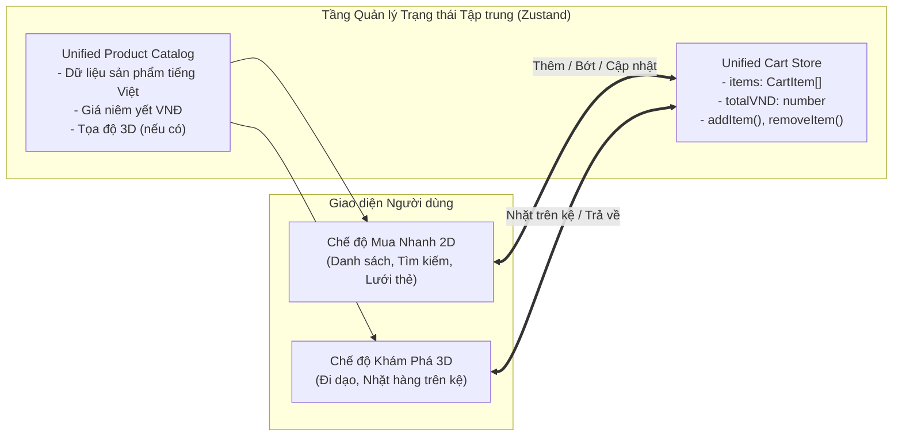
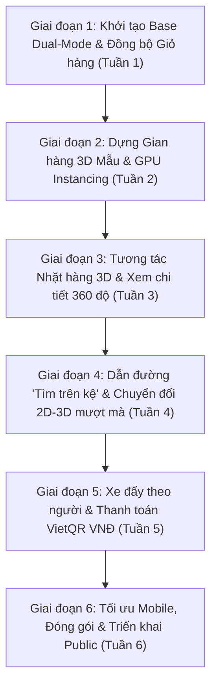

# BÁO CÁO PHÂN TÍCH VÀ ĐỀ ÁN PHÁT TRIỂN: SMARTMART 3D
> **Hệ quy chiếu kỹ thuật**: Dự án [Walmart — An Interactive 3D Supermarket (By Omid)](https://byomid.com/Walmart/)  
> **Định hướng phát triển**: Siêu thị Mua sắm Không gian Lai (Hybrid 2D & 3D E-Commerce) cho Thị trường Việt Nam  
> **Người thực hiện**: Antigravity  
> **Cập nhật ngày**: 2026-11-07

---

## 1. TỔNG QUAN DỰ ÁN GỐC (WALMART 3D CỦA BY OMID)

Dự án **"Walmart — An Interactive 3D Supermarket"** là một concept thử nghiệm bán lẻ không gian 3D tương tác trực tiếp trên trình duyệt web (Browser-based Spatial Retail Experience) do nhà thiết kế & kỹ sư **Omid Rasouli** (By Omid) phát triển.

### Mục tiêu & Ý tưởng cốt lõi của nguyên mẫu:
Thay vì người mua hàng chỉ cuộn xem danh sách sản phẩm dạng lưới 2D phẳng thông thường, nguyên mẫu Walmart 3D tái hiện một siêu thị thu nhỏ dưới dạng không gian 3D chân thực:
- Người dùng trực tiếp "bước vào", đi bộ qua từng lối đi (aisles).
- Nhìn thấy các biển chỉ dẫn ngành hàng, đi tới từng kệ hàng.
- Tìm kiếm sản phẩm thông qua công cụ tìm kiếm, sau đó hệ thống tự động **vẽ đường dẫn (pathfinding)** đưa người dùng đi bộ đến đúng vị trí kệ hàng đó.
- Nhặt sản phẩm bỏ vào xe đẩy vật lý đi theo mình, kiểm tra sản phẩm 3D xoay 360 độ và đẩy xe tới quầy **Self-checkout** mô phỏng quét mã in hóa đơn.

---

## 2. QUY MÔ & TÍNH NĂNG KỸ THUẬT NỔI BẬT

Theo công bố kỹ thuật trên trang dự án của Omid:

| Thông số / Thành phần | Quy mô trong Prototype | Chi tiết kỹ thuật |
| :--- | :--- | :--- |
| **Sản phẩm danh mục (Catalogue)** | **400 sản phẩm** riêng biệt | Các model 3D độc lập có texture bao bì, quy cách và giá |
| **Vị trí hàng hóa trên kệ** | **104,346 vị trí** (Stocked instances) | Sử dụng kỹ thuật **GPU Instancing** lặp lại 400 model gốc trên các kệ chứ không tạo 104k mesh riêng |
| **Cấu trúc nội thất (Fixtures)** | **290 cụm** kệ / quầy | Kệ gondola tiêu chuẩn, tủ đông lạnh, giá treo quần áo, quầy tính tiền |
| **Khu vực ngành hàng (Departments)** | **15 khu vực** | Nông sản tươi (Produce), Tạp hóa (Grocery), Bánh mì (Bakery), Thời trang (Apparel), Điện tử (Electronics), Đồ gia dụng, Sân vườn, Quầy thanh toán... |

### Các tính năng tương tác chính:
1. **Hệ thống điều khiển & Góc nhìn (Camera & Movement)**:
   - Hỗ trợ cả bàn phím (`W-A-S-D` / phím mũi tên) và điều khiển cảm ứng (Virtual Joystick / Swipe) trên thiết bị di động.
   - Xoay góc nhìn người thứ nhất (First-person) hoặc người thứ ba (Third-person).
   - **Chuyển đổi góc nhìn mặt bằng (Floor-plan view)**: Xem toàn cảnh siêu thị từ trên cao như một bản đồ tương tác (Minimap).
2. **Hệ thống định vị & Dẫn đường (Wayfinding & Pathfinding)**:
   - Gắn mã địa chỉ kệ (Shelf address) và biển báo trực quan.
   - Tính năng **"Find on shelf"**: Khi tìm kiếm sản phẩm trên danh mục, hệ thống sẽ vẽ vệt sáng dẫn đường trên sàn nhà đưa người dùng đến tận kệ chứa món hàng.
3. **Kiểm tra chi tiết sản phẩm (3D Product Inspection)**:
   - Khi đứng trong phạm vi gần (Within reach), click vào sản phẩm sẽ mở popup 3D cho phép xoay 360 độ, kiểm tra bao bì, chọn màu sắc/kích thước và xem thông số giá.
4. **Xe đẩy vật lý & Quầy Self-checkout**:
   - Chọn xe đẩy tại cửa ra vào, xe đẩy di chuyển bám theo góc đi của người chơi.
   - Giỏ hàng có sức chứa thể tích vật lý (giới hạn tối đa khoảng 24 gói hàng tùy kích thước hộp).
   - Quầy thanh toán tự động mô phỏng: Đưa từng món qua máy quét mã vạch (có hiệu ứng âm thanh/chuyển động) và in biên lai mẫu trên trình duyệt.
   - Lưu trữ giỏ hàng trong bộ nhớ cục bộ trình duyệt (LocalStorage / IndexedDB).
5. **Kỹ thuật tối ưu hóa 3D đỉnh cao**:
   - Màn hình tải có hoạt cảnh giới thiệu lối đi (Animated preview) để người dùng không cảm thấy lâu trong lúc engine dựng scene ngầm.
   - Kỹ thuật **LOD (Level of Detail)**: Kệ ở gần dựng chi tiết cao, kệ ở xa tự động giảm đa giác hoặc chuyển thành billboard nhẹ.
   - Tách biệt hoàn toàn luồng nạp dữ liệu sản phẩm với luồng dựng cảnh quan 3D.

---

## 3. CÁC CÔNG CỤ & CÔNG NGHỆ CẦN THIẾT (TECH STACK)

### 3.1. Thiết kế 3D & Xử lý Tài nguyên (3D Asset Pipeline)
- **DCC Tools**: **Blender** (Dựng kiến trúc, kệ hàng, nướng ánh sáng Lightmap baking).
- **Tạo mô hình sản phẩm**: 
  - **3D Scanning / Photogrammetry**: *RealityCapture*, *Polycam*, hoặc *Kiri Engine* quét từ sản phẩm thật.
  - **AI 3D Model Generation**: *Tripo3D*, *Meshy.ai*, hoặc *CSM* tạo draft model nhanh từ ảnh 2D.
- **Xử lý chất liệu & Texture**: *Adobe Substance 3D Painter* (chất liệu PBR: BaseColor, Normal, Roughness, Metalness).
- **Tối ưu hóa file 3D cho Web**: **glTF-Transform**, **Draco Compression** (giảm 70-80% dung lượng), **KTX2 / Basis Universal** (nén texture trực tiếp vào VRAM).

### 3.2. Lập trình Frontend & Engine 3D trên Web
- **3D Web Engine**: **React Three Fiber (R3F) + Three.js + `@react-three/drei`** (Lựa chọn tối ưu nhất để kết hợp giữa UI 2D truyền thống và Canvas 3D).
- **Vật lý & Va chạm**: **Rapier.js** (`@react-three/rapier` viết bằng Rust/Wasm, siêu nhẹ).
- **Hệ thống dẫn đường**: Prototype hiện dùng **A\* trên lưới mặt bằng đi được** cùng footprint vật cản. **three-pathfinding** hoặc **Recast/Detour NavMesh** là hướng mở rộng khi chuyển sang mặt bằng/model phức tạp.
- **Giao diện & Quản lý trạng thái**: **React + TypeScript + Tailwind CSS**, **Zustand** (quản lý state giỏ hàng dùng chung).

### 3.3. Backend & Lưu trữ
- **Backend API**: Node.js (NestJS / Express) hoặc Python (FastAPI).
- **Cơ sở dữ liệu**: PostgreSQL + PostGIS (lưu tọa độ `x, y, z`, danh mục, mã kệ).
- **CDN**: Cloudflare R2 / AWS S3 + CDN để tải file `.glb` nhanh chóng.

---

## 4. ĐÁNH GIÁ TÍNH KHẢ DỤNG NGUYÊN MẪU THUẦN 3D

```
+---------------------------------------------------------------------------------+
|                      ĐÁNH GIÁ NGUYÊN MẪU THUẦN 3D TRUYỀN THỐNG                  |
+----------------------+--------------------+-------------------------------------+
| Tiêu chí             | Điểm khả dụng      | Nhận định                           |
+----------------------+--------------------+-------------------------------------+
| 1. Kỹ thuật Web 3D   | 9 / 10 (Rất cao)   | WebGL 2.0 & WebGPU hoàn toàn đáp ứng|
| 2. Chi phí sản xuất  | 4 / 10 (Khó khăn)  | Khối lượng dựng 400+ 3D quá đắt đỏ  |
| 3. Trải nghiệm E-com | 3 / 10 (Bất tiện)  | Mua sắm chậm chạp so với web 2D     |
| 4. Marketing/Showroom| 9 / 10 (Tuyệt vời) | Gây ấn tượng mạnh, viral tốt        |
+----------------------+--------------------+-------------------------------------+
```

* **Vấn đề cốt tử của mô hình thuần 3D**: Khách hàng đi chợ online cần tốc độ (tìm đồ và thanh toán trong 30 giây). Bắt người dùng "đi bộ ảo" qua 15 dãy kệ sẽ gây mỏi tay và ức chế sau vài phút. Hơn nữa, chi phí dựng hàng nghìn sản phẩm 3D là gánh nặng khổng lồ.

---

## 5. ĐỀ XUẤT ĐỘT PHÁ: DỰ ÁN "SMARTMART 3D" (HYBRID E-COMMERCE VIỆT NAM)

> **Nhận định về ý tưởng SmartMart 3D**:  
> Đây là một **ý tưởng cực kỳ xuất sắc và mang tính đột phá cao (10/10)**, trực tiếp giải quyết 2 rào cản lớn nhất của thương mại 3D: **tốc độ mua sắm** và **chi phí sản xuất tài nguyên**.

### 5.1. Triết lý Thiết kế: Mô hình Mua sắm Lai (Dual-Mode Hybrid)
Thay vì bắt khách hàng chỉ được chọn 2D hoặc 3D, hệ thống cung cấp **chế độ chuyển đổi linh hoạt 1-click**:

1. **Chế độ 1: Mua Nhanh (2D Quick Shop)**:
   - Giao diện dạng danh sách / lưới thẻ sản phẩm quen thuộc giống Shopee, Bách Hóa Xanh, Tiki.
   - Thanh tìm kiếm tức thời (Instant search), bộ lọc ngành hàng, phân loại theo giá VNĐ.
   - Thêm nhanh vào giỏ hàng với 1 click chuột, điều chỉnh số lượng (+/-) tức thì.
   - Thích hợp khi: Khách bận rộn, mua đồ lặt vặt hàng ngày, mua nhiều món cùng lúc.

2. **Chế độ 2: Khám Phá 3D (3D Immersive Spatial Shop)**:
   - Bước chân vào không gian siêu thị 3D với góc nhìn người thứ nhất (`W-A-S-D` hoặc cảm ứng).
   - Tham quan các gian hàng tiêu biểu (Feature Aisles), nhìn ngắm sản phẩm xếp trên kệ.
   - Click vào sản phẩm để mở hộp xoay 360 độ, nhặt hàng vào xe đẩy vật lý.
   - Có vệt sáng dẫn đường "Tìm trên kệ" nếu muốn biết món hàng nằm ở đâu trong siêu thị.
   - Thích hợp khi: Khách có thời gian dạo chơi, tìm kiếm cảm giác mới lạ, muốn xem kỹ bao bì sản phẩm khuyến mãi hoặc quà tặng.

### 5.2. Trái tim Hệ thống: Cơ chế Đồng bộ Giỏ hàng 2 Chiều (Unified Cart State)
Hai chế độ sử dụng chung **một nguồn dữ liệu duy nhất (Single Source of Truth)**. Người dùng có thể tự do luân chuyển qua lại mà không mất dữ liệu:



#### Kịch bản thực tế:
1. Khách hàng bật chế độ 3D, đi dạo và nhặt **1 Hộp Sữa Tươi Vinamilk 1L** (38.000 đ) trên kệ vào giỏ hàng.
2. Khách nhớ ra cần mua thêm bột giặt nhưng lười đi bộ tìm quầy chất tẩy rửa $\rightarrow$ Bấm nút **"Chuyển sang Mua Nhanh 2D"**.
3. Màn hình chuyển sang giao diện danh sách quen thuộc. Góc trên giỏ hàng **vẫn hiển thị 1 món (38.000 đ)**.
4. Khách gõ ô tìm kiếm: *"Bột giặt OMO"* $\rightarrow$ Click *"Thêm vào giỏ"* (145.000 đ). Giỏ hàng tự động cập nhật thành **2 món (183.000 đ)**.
5. Khách tò mò muốn xem quầy bánh mì 3D $\rightarrow$ Bấm quay lại **"Khám Phá 3D"**. Xe đẩy trong không gian 3D lập tức đồng bộ hiển thị các sản phẩm đã chọn!

### 5.3. Chiến lược MVP Thu Nhỏ (Smart Scope): Giảm 90% Chi phí & Thời gian
Ở các bước đầu, **chúng ta không cần và không nên dựng toàn bộ hàng nghìn sản phẩm 3D**:

* **Trong Cơ sở dữ liệu 2D (Danh mục đầy đủ)**: Có thể chứa 500 - 1,000 mặt hàng bình thường (chỉ cần ảnh chụp 2D, tên tiếng Việt, giá VNĐ như web thương mại điện tử thông thường).
* **Trong Không gian 3D (Gian hàng tiêu biểu - Showcase Aisles)**:
  - Chỉ dựng **1 lối đi mẫu (Aisle 01)** với **2 dãy kệ**.
  - Chỉ cần chuẩn bị mô hình 3D cho khoảng **10 - 20 sản phẩm nổi bật** (Ví dụ: Nước giải khát, Sữa tươi, Bánh snack, Cà phê lon).
  - Sử dụng kỹ thuật **GPU Instancing** để nhân bản 10-20 model này lấp đầy các tầng kệ, tạo cảm giác siêu thị phong phú, nhộn nhịp mà dung lượng tải chỉ tốn **dưới 5MB**!
  - Các sản phẩm khác nếu chưa có 3D: Khi tìm kiếm trong 3D, hệ thống sẽ hiện thông báo *"Sản phẩm có sẵn ở chế độ Mua Nhanh"* kèm nút bấm chuyển sang 2D ngay lập tức.

### 5.4. Bản địa hóa Toàn diện Thị trường Việt Nam
- **Ngôn ngữ**: 100% Tiếng Việt (Biển hiệu siêu thị: "Khu Bánh Kẹo", "Quầy Sữa & Nước Giải Khát", "Quầy Thu Ngân Tự Động").
- **Đơn vị tiền tệ**: VNĐ chuẩn định dạng Việt Nam (`45.000 đ`, `120.000 đ`), tính toán tổng tiền, VAT 8-10%.
- **Thanh toán tích hợp**: Quầy Self-checkout mô phỏng quét mã **VietQR**, **MoMo**, **ZaloPay** hoặc Thanh toán khi nhận hàng (COD).

---

## 6. HƯỚNG DẪN XÂY DỰNG NỀN TẢNG (BASE) ĐẦU TIÊN CHO SMARTMART 3D

### 6.1. Khởi tạo Dự án & Cài đặt Thư viện
```bash
# 1. Tạo project Vite React TypeScript
npm create vite@latest smartmart-3d -- --template react-ts
cd smartmart-3d

# 2. Cài đặt các thư viện 3D cốt lõi (React 18 / Three.js)
npm install three @types/three @react-three/fiber @react-three/drei

# 3. Cài đặt thư viện quản lý trạng thái, icon & UI
npm install zustand lucide-react clsx tailwind-merge

# 4. Cài đặt Tailwind CSS
npm install -D tailwindcss postcss autoprefixer
npx tailwindcss init -p
```

### 6.2. Cấu trúc Thư mục Dự án Lai (Hybrid Project Structure)
```text
smartmart-3d/
├── public/
│   ├── assets/
│   │   ├── models/           # File 3D (.glb) nén: kệ hàng, xe đẩy, sản phẩm mẫu
│   │   └── textures/         # Texture PBR: gạch sàn siêu thị, biển hiệu tiếng Việt
│   └── data/
│       └── products.json     # Kho dữ liệu chung (Single Source of Truth)
├── src/
│   ├── components/
│   │   ├── 2d/               # CHẾ ĐỘ MUA NHANH 2D
│   │   │   ├── QuickShopView.tsx    # Giao diện lưới sản phẩm 2D
│   │   │   ├── ProductCard2D.tsx    # Thẻ sản phẩm với nút thêm giỏ hàng
│   │   │   └── CategoryFilter.tsx   # Bộ lọc ngành hàng tiếng Việt
│   │   ├── 3d/               # CHẾ ĐỘ KHÁM PHÁ 3D
│   │   │   ├── Scene3D.tsx          # Canvas Three.js, ánh sáng, môi trường
│   │   │   ├── PlayerFPS.tsx        # Điều khiển góc nhìn người thứ nhất (WASD)
│   │   │   ├── AisleGondola.tsx     # Dãy kệ hàng siêu thị
│   │   │   ├── InstancedStock.tsx   # Render hàng nghìn hộp bánh/sữa mượt 60fps
│   │   │   ├── SpatialShopHUD.tsx   # Tìm kiếm, ngành hàng, minimap, giỏ hàng nổi trong 3D
│   │   │   ├── NavigationGuide.tsx  # Vệt dẫn đường và beacon tại kệ đích
│   │   │   ├── FloorPlanMap.tsx     # Bản đồ tương tác, vị trí/hướng người chơi và đường đi
│   │   │   ├── NavigationPanel.tsx  # Khoảng cách, tự đi, hủy và thông báo tới đích
│   │   │   ├── StoreFixtures.tsx    # Biển ngành hàng, đảo khuyến mãi, quầy self-checkout
│   │   │   ├── ProductInteraction.tsx # Raycast tầm với 2,5 m, E/click và viền chọn instance
│   │   │   ├── InteractionHUD.tsx   # Tên, giá, khoảng cách và hướng dẫn điều khiển
│   │   │   ├── ProductPreview3D.tsx # Xoay, zoom, tạm dừng và đặt lại góc nhìn
│   │   │   └── ProductInspector3D.tsx# Modal xem sản phẩm xoay 360 độ
│   │   └── shared/           # GIAO DIỆN DÙNG CHUNG CẢ 2 CHẾ ĐỘ
│   │       ├── HeaderNavbar.tsx     # Nút gạt chuyển đổi [2D Mua Nhanh] <-> [3D Khám Phá]
│   │       ├── CartDrawer.tsx       # Giỏ hàng bên phải màn hình (luôn đồng bộ)
│   │       ├── CartFeedback.tsx     # Thông báo thêm hàng thành công, tự đóng
│   │       └── CheckoutModal.tsx    # Quét mã QR VNĐ thanh toán
│   ├── stores/
│   │   ├── useCartStore.ts   # Quản lý giỏ hàng chung (Zustand + LocalStorage)
│   │   ├── useFeedbackStore.ts # Thông báo thêm giỏ và tùy chọn bật/tắt âm
│   │   ├── useNavigationStore.ts # Vị trí, hướng nhìn, tuyến A* và trạng thái dẫn đường
│   │   ├── useProductStore.ts# Quản lý danh mục & trạng thái sản phẩm
│   │   └── useAppModeStore.ts# Quản lý chế độ hiện tại ('2D' | '3D')
│   ├── types/
│   │   └── index.ts          # Định nghĩa Product, CartItem, Department
│   ├── App.tsx               # Component gốc điều phối hiển thị 2D / 3D
│   └── main.tsx
```

### 6.3. Mã nguồn Quản lý Trạng thái Giỏ hàng Chung (`useCartStore.ts`)
```typescript
import { create } from "zustand";
import { persist } from "zustand/middleware";

export interface Product {
  id: string;
  name: string;
  price: number; // Đơn vị: VNĐ
  category: string;
  image2D: string;
  has3DModel: boolean;
  modelType?: string;
  stockPositions?: [number, number, number][]; // Tọa độ trong 3D
}

export interface CartItem {
  product: Product;
  quantity: number;
}

interface CartState {
  items: CartItem[];
  addItem: (product: Product) => void;
  removeItem: (productId: string) => void;
  updateQuantity: (productId: string, quantity: number) => void;
  clearCart: () => void;
  getTotalVND: () => number;
  getTotalItems: () => number;
}

export const useCartStore = create<CartState>()(
  persist(
    (set, get) => ({
      items: [],
      addItem: (product) => {
        const currentItems = get().items;
        const existing = currentItems.find((i) => i.product.id === product.id);
        if (existing) {
          set({
            items: currentItems.map((i) =>
              i.product.id === product.id ? { ...i, quantity: i.quantity + 1 } : i
            ),
          });
        } else {
          set({ items: [...currentItems, { product, quantity: 1 }] });
        }
      },
      removeItem: (productId) => {
        set({ items: get().items.filter((i) => i.product.id !== productId) });
      },
      updateQuantity: (productId, quantity) => {
        if (quantity <= 0) {
          get().removeItem(productId);
          return;
        }
        set({
          items: get().items.map((i) =>
            i.product.id === productId ? { ...i, quantity } : i
          ),
        });
      },
      clearCart: () => set({ items: [] }),
      getTotalVND: () =>
        get().items.reduce((sum, item) => sum + item.product.price * item.quantity, 0),
      getTotalItems: () =>
        get().items.reduce((sum, item) => sum + item.quantity, 0),
    }),
    { name: "smartmart-cart-storage" }
  )
);
```

### 6.4. Bộ Điều phối Giao diện Chuyển đổi 2D $\leftrightarrow$ 3D (`App.tsx`)
```tsx
import React, { useState } from "react";
import { HeaderNavbar } from "./components/shared/HeaderNavbar";
import { QuickShopView } from "./components/2d/QuickShopView";
import { Scene3D } from "./components/3d/Scene3D";
import { CartDrawer } from "./components/shared/CartDrawer";

export const App: React.FC = () => {
  const [mode, setMode] = useState<"2D" | "3D">("2D");
  const [isCartOpen, setIsCartOpen] = useState(false);

  return (
    <div className="relative w-screen h-screen overflow-hidden bg-slate-900 text-white flex flex-col font-sans">
      {/* 1. Thanh điều hướng dùng chung: Chuyển chế độ 2D <-> 3D */}
      <HeaderNavbar
        currentMode={mode}
        onToggleMode={(newMode) => setMode(newMode)}
        onOpenCart={() => setIsCartOpen(true)}
      />

      {/* 2. Khu vực hiển thị: Thay đổi theo chế độ đã chọn */}
      <main className="flex-1 relative overflow-hidden">
        {mode === "2D" ? (
          <div className="w-full h-full overflow-y-auto p-6 bg-slate-50 text-slate-800">
            <QuickShopView onSwitchTo3D={() => setMode("3D")} />
          </div>
        ) : (
          <div className="w-full h-full relative">
            <Scene3D />
            {/* HUD tâm ngắm & phím tắt cho 3D */}
            <div className="absolute inset-0 pointer-events-none flex items-center justify-center">
              <div className="w-2 h-2 bg-white/80 rounded-full border border-black/30 shadow" />
            </div>
          </div>
        )}
      </main>

      {/* 3. Giỏ hàng Drawer: Luôn hiển thị dữ liệu đồng bộ dù ở 2D hay 3D */}
      <CartDrawer isOpen={isCartOpen} onClose={() => setIsCartOpen(false)} />
    </div>
  );
};

export default App;
```

---

## 7. KẾ HOẠCH PHÂN CHIA 6 GIAI ĐOẠN TRIỂN KHAI TỪNG BƯỚC



---

### GIAI ĐOẠN 1: KHỞI TẠO NỀN TẢNG HYBRID DUAL-MODE (BASE FOUNDATION)
*Thời lượng: 3 - 5 ngày*

* **Mục tiêu**: Xây dựng bộ khung ứng dụng kết hợp 2D và 3D với hệ thống giỏ hàng dùng chung hoạt động ổn định.
* **Nhiệm vụ cụ thể**:
  - [x] Cài đặt dự án với Vite + React 18 + TypeScript + Three.js + Tailwind CSS.
  - [x] Tạo `useCartStore` bằng Zustand, có lưu trữ `localStorage` và tính tổng tiền VNĐ.
  - [x] Tạo thanh Header với nút gạt: `[⚡ Mua Nhanh 2D]` $\leftrightarrow$ `[🎮 Khám Phá 3D]`.
  - [x] Tạo màn hình 2D với 12 sản phẩm Việt Nam mẫu (Sữa Vinamilk, Mì Hảo Hảo, Cà phê G7, Nước ngọt...).
  - [x] Tạo màn hình 3D cơ bản với mặt sàn siêu thị, ánh sáng và camera di chuyển bằng phím `WASD`.
* **Nghiệm vụ**: Bấm thêm 2 gói mì ở 2D $\rightarrow$ bấm sang 3D $\rightarrow$ giỏ hàng vẫn lưu đúng 2 gói mì và tổng tiền VNĐ chính xác.

---

### GIAI ĐOẠN 2: DỰNG GIAN HÀNG 3D MẪU & RENDER HÀNG LOẠT (INSTANCING)
*Thời lượng: 5 - 7 ngày*

* **Mục tiêu**: Xây dựng 1 lối đi siêu thị mẫu (Aisle 01) với 2 dãy kệ chứa hàng nghìn sản phẩm nhưng FPS luôn đạt **60 FPS**.
* **Nhiệm vụ cụ thể**:
  - [x] Thiết kế 2 dãy kệ hàng Gondola bằng Blender hoặc hình học cơ bản có vách ngăn, khay giá.
  - [x] Chuẩn bị texture nhãn dán cho 5 sản phẩm đặc trưng: Sữa tươi, Nước ngọt lon, Bánh hộp, Snack gói, Cà phê.
  - [x] Viết component `InstancedStock.tsx` sử dụng `THREE.InstancedMesh`.
  - [x] Rải tự động 1,500 - 3,000 sản phẩm lên các tầng kệ bằng thuật toán ma trận tọa độ.
  - [x] Kiểm tra hiệu năng: Số lệnh vẽ (Draw calls) $\le 20$, FPS đạt 60 trên trình duyệt máy tính.
* **Nghiệm vụ**: Bước vào 3D thấy các kệ hàng đầy ắp sản phẩm, di chuyển trơn tru, không có hiện tượng giật hình.

---

### GIAI ĐOẠN 3: TƯƠNG TÁC NHẶT HÀNG & MODAL 3D 360 ĐỘ
*Thời lượng: 5 - 7 ngày*

**Trạng thái: Hoàn thành chức năng prototype.** Thông tin bao bì hiện là mẫu minh họa; dữ liệu thành phần và hạn dùng theo lô thực tế sẽ do nhà cung cấp bổ sung.

* **Mục tiêu**: Hiện thực hóa thao tác nhặt hàng trên kệ 3D và xem chi tiết sản phẩm.
* **Nhiệm vụ cụ thể**:
  - [x] Dùng `THREE.Raycaster` từ tâm camera khi khóa chuột; khi con trỏ tự do, cho phép trỏ/click trực tiếp trên hàng.
  - [x] Chỉ cho chọn bề mặt sản phẩm trong bán kính **2,5 m**, lấy món gần nhất và không cho nhặt xuyên vách/tầng kệ.
  - [x] HUD hiển thị tên tiếng Việt, đơn vị, giá VNĐ và khoảng cách. Viền sáng bám đúng **instance** được chọn, không tô cả lô hàng.
  - [x] Bấm `E` hoặc click để mở **ProductInspector3D** dạng side-sheet bên phải. Raycast được kiểm tra lại ngay khi kích hoạt để không dùng mục tiêu cũ sau khi camera đã di chuyển.
  - [x] Preview hỗ trợ kéo xoay 360°, cuộn phóng to, bật/tắt tự xoay và đặt lại góc nhìn. Dùng ánh sáng cục bộ, không phụ thuộc tải HDR từ CDN.
  - [x] Panel hiển thị thành phần, bảo quản và hướng dẫn xem NSX/HSD; dữ liệu mẫu được ghi nhãn rõ ràng, không tạo ngày hết hạn giả.
  - [x] Nút "Bỏ vào giỏ" gọi `addItem()`, phát âm "ting" bằng Web Audio và hiển thị thông báo tự đóng sau 3,2 giây. Có công tắc tắt âm và nút mở giỏ.
  - [x] Khi mở inspector/giỏ/checkout: Dừng nhận phím di chuyển và nhả pointer lock. Không nhận WASD/E khi gõ tìm kiếm; xóa phím giữ khi mất focus.
  - [x] `Esc` hoặc nút X đóng panel và trả focus; không tự khóa lại chuột. Nút "Dạo bằng chuột" chủ động khóa con trỏ; giữ chuột phải để nhìn là chế độ dự phòng.
* **Nghiệm thu**: Đứng trước kệ Vinamilk trong tầm với, bấm `E`, xoay/xem sản phẩm rồi chọn "Bỏ vào giỏ" → giỏ tăng **1 hộp / 36.000 đ**, hiện thông báo thành công. Ra khỏi tầm 2,5 m không thể mở sản phẩm trên kệ đó.

#### Kiến trúc và kiểm thử giai đoạn 3

- [ProductInteraction.tsx](./src/components/3d/ProductInteraction.tsx) điều phối raycast, phím `E`, click và viền chọn; quét hover tối đa khoảng 15 lần/giây, đồng thời kiểm tra lại khi nhặt.
- [spatialInteraction.ts](./src/utils/spatialInteraction.ts) chứa quy tắc tầm với, vật cản và di chuyển theo camera. Unit test dùng mesh/instanced mesh Three.js thật, không chép lại thuật toán production.
- [PlayerFPS.tsx](./src/components/3d/PlayerFPS.tsx) quản lý chuột/phím và vòng đời pause/resume. Đồng thời sửa lỗi A/D bị đảo và giữ tốc độ ngang khi nhìn lên/xuống.
- [ProductPreview3D.tsx](./src/components/3d/ProductPreview3D.tsx) tách phần WebGL khỏi [ProductInspector3D.tsx](./src/components/3d/ProductInspector3D.tsx) để kiểm thử luồng giỏ hàng mà không cần GPU.
- [cartSound.ts](./src/utils/cartSound.ts) chỉ tạo âm sau thao tác người dùng; trình duyệt chặn hoặc thiếu Web Audio không làm lỗi thao tác thêm giỏ.
- Nhóm test bổ sung kiểm tra giới hạn 2,5 m, che khuất, đúng instance, mục tiêu cũ, phím `E`, click, input focus, nhả pointer lock, dọn listener, giỏ hàng, tắt âm và vòng đời thông báo.
- Lệnh kiểm tra: `npm test` và `npm run build`. Kiểm tra trình duyệt thực tế bổ sung cho `E`/click, zoom/tự xoay, thêm giỏ và nút mua trên viewport 390 × 844.
- **Kết quả nghiệm thu**: 18 file test, **91/91 test pass** (thêm 30 test ở giai đoạn 3); TypeScript và production build thành công. Trình duyệt đã xác nhận `E`/click mở đúng sản phẩm, thêm 1 hộp sữa tăng tổng tiền 36.000 đ, và ra khỏi tầm với không mở lại mục tiêu cũ. Chuyển động xoay/zoom do OrbitControls xử lý; dữ liệu bao bì vẫn là mẫu minh họa.

---

### GIAI ĐOẠN 4: TÍNH NĂNG "TÌM TRÊN KỆ" (PATHFINDING) & LIÊN KẾT 2D-3D
*Thời lượng: 7 - 10 ngày*

**Trạng thái: Hoàn thành chức năng prototype trên mặt bằng hiện tại.** Dùng A\* trên lưới 0,2 m và vật cản tĩnh, chưa dùng NavMesh tam giác hoặc hệ thống vật lý đầy đủ.

* **Mục tiêu**: Kết nối sâu sắc giữa 2 chế độ: Đang ở 2D có thể bấm "Xem vị trí trong 3D", và ở 3D có thể tìm đường tới kệ.
* **Nhiệm vụ cụ thể**:
  - [x] Từ 2D: "Tìm trên kệ" chuyển vào 3D, chọn điểm đứng an toàn trước kệ và hướng camera vào một instance sản phẩm thật.
  - [x] Từ 3D: Tìm tên/ngành hàng có dấu hoặc không dấu, chọn sản phẩm để lập tuyến **từ vị trí hiện tại**, không dịch chuyển camera ngay lập tức.
  - [x] A\* né hai dãy kệ, đầu hồi, đảo khuyến mãi và quầy checkout. Tính khoảng trống theo bán kính người chơi 0,22 m, cấm cắt chéo góc vật cản, rút gọn tuyến chỉ khi toàn bộ đoạn nối đi được.
  - [x] Vệt sáng chuyển động trên sàn và beacon dùng đường thật của A\*. Cập nhật tuyến, khoảng cách còn lại và hướng nhìn theo chuyển động người chơi.
  - [x] Có trạng thái đang dẫn đường / đã đến / không tìm được lối đi, nút hủy và thử lại. Hủy cũng xóa lệnh chuyển vị trí còn chờ xử lý.
  - [x] Nút **"Tự động đi tới kệ"** di chuyển camera theo tuyến; tới nơi tự dừng và quay về sản phẩm. WASD, giữ chuột phải, gõ tìm kiếm, mở panel/giỏ/checkout hoặc mất focus sẽ dừng tự đi.
  - [x] Cả di chuyển tay và tự đi dùng cùng kiểm tra va chạm footprint; không xuyên kệ/đảo/quầy và không lọt ra ngoài sàn.
  - [x] Minimap có mặt bằng thật, vị trí/hướng của bạn, tuyến đi, đích đang chọn và chấm sản phẩm bấm được. Hỗ trợ bàn phím, phóng to/thu nhỏ và đóng bằng Esc. Trên màn hình nhỏ, chọn đích sẽ thu bản đồ lại.
  - [x] Sản phẩm chưa có 3D vẫn xuất hiện trong tìm kiếm; nút "Mua nhanh 2D" chuyển đến đúng sản phẩm, bỏ bộ lọc cũ và giữ nguyên giỏ hàng.
  - [x] Chuyển qua 2D rồi trở lại 3D giữ vị trí/hướng nhìn trong phiên hiện tại, không đưa người chơi về cửa vào.
* **Nghiệm thu**: Vào 3D từ cửa → chọn Vinamilk trên bản đồ → thấy tuyến né đảo khuyến mãi → tự đi tới kệ → bấm E mở đúng hộp sữa. Tìm "gao st25" → chuyển mua nhanh 2D → giỏ giữ nguyên; quay lại 3D vẫn ở vị trí cũ.

#### Kiến trúc và phạm vi giai đoạn 4

| Thành phần | Trách nhiệm |
| :--- | :--- |
| [storeLayout.ts](./src/data/storeLayout.ts) | Kích thước kệ, đảo, checkout; footprint dùng chung cho scene, bản đồ, dẫn đường và va chạm |
| [pathfinding.ts](./src/utils/pathfinding.ts) | A\*, min-heap, kiểm tra đoạn di chuyển, điểm đứng trước kệ và chiều dài tuyến |
| [useNavigationStore.ts](./src/stores/useNavigationStore.ts) | Vị trí/hướng người chơi, tuyến hiện tại, khoảng cách, trạng thái tới đích và tự đi |
| [PlayerFPS.tsx](./src/components/3d/PlayerFPS.tsx) | Di chuyển có va chạm, theo tuyến, dừng tự đi theo ngữ cảnh và lưu pose khi rời 3D |
| [NavigationGuide.tsx](./src/components/3d/NavigationGuide.tsx) | Vệt sáng và beacon trong không gian 3D |
| [FloorPlanMap.tsx](./src/components/3d/FloorPlanMap.tsx), [NavigationPanel.tsx](./src/components/3d/NavigationPanel.tsx) | Chọn đích trực tiếp, theo dõi vị trí/tuyến, điều khiển tự đi và hủy |
| [productSearch.ts](./src/utils/productSearch.ts) | Tìm tiếng Việt không dấu, thống nhất ở 2D và 3D |

- Tính lại đường khi pose được cập nhật, tối đa khoảng 10 lần/giây trong lúc di chuyển; không gửi vị trí camera vào toàn bộ app store mỗi frame.
- Khi tới kệ, camera chọn tâm một instance thật gần địa chỉ sản phẩm. Cách này tránh ngắm vào khe trống giữa hai lon/chai; phím E luôn raycast từ tâm camera, click tự do vẫn theo con trỏ.
- Mặt bằng hiện tại là một tầng với vật cản tĩnh. Chưa có NavMesh tam giác, cầu thang, vật cản chuyển động hoặc va chạm Rapier; không đánh đồng footprint với mô phỏng vật lý.
- Unit test kiểm tra từng đoạn tuyến trên đủ 8 kệ, đường vòng qua đầu kệ, góc chéo, vùng bị ngăn kín, tọa độ không hợp lệ, vòng đời tự đi, hủy lệnh chờ và liên kết 2D–3D. Các test giai đoạn 3 vẫn được chạy hồi quy.
- **Kết quả kiểm tra ngày 2026-11-07**: `npm test` đạt **20 file / 123 test pass** (thêm 32 test so với giai đoạn 3); `npm run build` và TypeScript thành công, không có lỗi diagnostics. Đã kiểm tra trên trình duyệt: chọn đích trên bản đồ, tự đi tới Vinamilk/Milo/Simply rồi mở đúng món bằng E, tìm "gao st25" chuyển sang 2D mà giữ giỏ, quay lại 3D giữ pose, và chọn đích/hiển thị nút tự đi ở viewport 390 × 844.

---

### GIAI ĐOẠN 5: XE ĐẨY VẬT LÝ & QUẦY TÍNH TIỀN VIETQR (SELF-CHECKOUT)
*Thời lượng: 5 - 7 ngày*

* **Mục tiêu**: Mô phỏng trọn vẹn văn hóa mua sắm siêu thị với xe đẩy và quét mã thanh toán Việt Nam.
* **Nhiệm vụ cụ thể**:
  - [x] Thêm mô hình xe đẩy hàng wire mesh bám theo bước chân người chơi trong không gian 3D ([ShoppingTrolley.tsx](./src/components/3d/ShoppingTrolley.tsx)) có tay cầm cam Persimmon và chuyển động lắc nhẹ (sway & bobbing).
  - [x] Sản phẩm khi nhặt sẽ có animation thu nhỏ bay theo đường cong parabol rơi vào lòng xe đẩy, tự động xếp các khối 3D trong giỏ hàng.
  - [x] Dựng quầy tính tiền tự động 3 trạm vật lý (Bàn đặt hàng, POS quét laser, Bàn đóng túi có túi giấy SmartMart) ở lối đi, có màn hình hiện số món, tổng tiền và đèn trần AVAILABLE ([StoreFixtures.tsx](./src/components/3d/StoreFixtures.tsx)).
  - [x] Click vào màn hình quầy hoặc nút HUD sẽ mở luồng checkout đa bước (Đặt hàng ➔ Quét mã & đóng túi ➔ Thanh toán).
  - [x] Hệ thống hiển thị bảng kê, tổng tiền VNĐ, âm thanh máy quét mã vạch 2.4kHz ([cartSound.ts](./src/utils/cartSound.ts)) và QR demo theo mã đơn ổn định. Trạng thái xác nhận báo "Túi hàng của bạn đã sẵn sàng!". Tích hợp **VietQR ngân hàng thật** cần API/merchant hợp lệ và không nằm trong bản prototype hiện tại.
* **Nghiệm thu**: Trải nghiệm cảm giác đẩy xe tới quầy, nghe tiếng tít tít máy quét mã, nhìn thấy món đồ rơi vào giỏ và hiện mã QR thanh toán quen thuộc của Việt Nam. Toàn bộ tính năng đã hoàn thành và tích hợp vào scene 3D.

---

### GIAI ĐOẠN 6: TỐI ƯU HÓA MOBILE, ĐÓNG GÓI & TRIỂN KHAI (DEPLOY)
*Thời lượng: 5 - 7 ngày*

* **Mục tiêu**: Chạy mượt mà trên điện thoại smartphone và đưa lên hosting công khai.
* **Nhiệm vụ cụ thể**:
  - [x] Phát hiện thiết bị di động: Tự động bổ sung cần điều khiển ảo (Virtual Joystick) trên màn hình cảm ứng ([VirtualJoystick.tsx](./src/components/3d/VirtualJoystick.tsx)) để di chuyển và vuốt màn hình cảm ứng để xoay camera ([PlayerFPS.tsx](./src/components/3d/PlayerFPS.tsx)).
  - [x] Tối ưu hóa hiệu năng mobile: Giới hạn pixel ratio `dpr={[1, 1.8]}` chống tụt FPS/quá nhiệt trên màn hình Retina; tối ưu instanced rendering.
  - [x] Màn hình Loading mở đầu với hoạt cảnh giới thiệu siêu thị và tiến trình nạp (%) ([LoadingScreen.tsx](./src/components/shared/LoadingScreen.tsx)), kèm hướng dẫn điều khiển cho cả Desktop & Mobile.
  - [x] Đóng gói build dự án bằng `vite build` và cấu hình triển khai SPA ([vercel.json](./vercel.json)) lên **Vercel** hoặc **Cloudflare Pages**.
* **Nghiệm thu**: Mở web trên điện thoại iPhone/Android hoặc giả lập viewport di động (390 × 844) chạy mượt mà ở cả chế độ 2D và 3D, có cần gạt ảo và vuốt xoay 360°. Toàn bộ 22 file test / 128 tests đạt 100%.

---

## 8. BẢNG TIẾN ĐỘ VÀ PHÂN BỔ CÔNG VIỆC

| Giai đoạn | Trọng tâm công việc | Thời gian | Kết quả bàn giao (Deliverable) |
| :--- | :--- | :--- | :--- |
| **Giai đoạn 1** | Base Dual-Mode 2D & 3D, Giỏ hàng dùng chung | Hoàn thành prototype | Web chuyển đổi mượt 2D $\leftrightarrow$ 3D, giỏ hàng đồng bộ 100% |
| **Giai đoạn 2** | Gian hàng 3D mẫu & GPU Instancing | Hoàn thành prototype | 1 lối đi siêu thị chứa 2,000+ món hàng đạt 60 FPS |
| **Giai đoạn 3** | Raycasting nhặt đồ & Inspector 360° | Hoàn thành prototype | E/click trong tầm 2,5 m, xem 360°, âm báo và giỏ đồng bộ |
| **Giai đoạn 4** | Tìm trên kệ, A\* & bản đồ tương tác | Hoàn thành prototype | Tuyến từ vị trí thật, né vật cản, tự đi, minimap và liên kết 2D–3D |
| **Giai đoạn 5** | Xe đẩy hàng & Quầy tính tiền VietQR | Hoàn thành prototype | Xe đẩy FPS wire mesh, animation rơi đồ, Kiosk 3D 3 trạm và VietQR đa bước |
| **Giai đoạn 6** | Tối ưu Mobile, LOD & Triển khai Public | Hoàn thành prototype | Cần gạt Virtual Joystick, vuốt xoay cảm ứng, Loading Screen %, vercel.json và build dist |

---

## 9. BỔ SUNG TRẢI NGHIỆM THEO VIDEO THAM CHIẾU 3D HYPERMARKET

> **Video đối chiếu**: `D:\Downloads\3D HYPERMARKET WEBSITE 🛒Websites in 2026 are INSANE 🤯You dont just browse products. You WALK .mp4`  
> **Thời lượng đã phân tích**: 28,49 giây, khung hình dọc 720 × 1280.  
> **Tài liệu đề án chi tiết hóa**: Xem [HYPERMARKET_3D_DEVELOPMENT_PLAN.md](./HYPERMARKET_3D_DEVELOPMENT_PLAN.md)  
> **Ngày triển khai bổ sung**: 2026-11-07.  

### 9.1. Các mẫu trải nghiệm rút ra từ video

Video thể hiện một website bán lẻ không chỉ cho xem catalogue mà đặt người dùng trực tiếp vào không gian siêu thị. Các mẫu giao diện quan trọng được dùng làm tham chiếu gồm:

1. **Scene 3D là nội dung chính**: Camera đi bộ giữa các dãy kệ đầy sản phẩm, biển ngành hàng có màu nhận diện mạnh và ánh sáng trần liên tục.
2. **Navigation nổi trên scene**: Thanh tìm kiếm, chip ngành hàng và tổng tiền giỏ hàng luôn nhìn thấy mà không cần rời khỏi không gian 3D.
3. **Product side-sheet**: Click sản phẩm mở panel thông tin ở cạnh phải; scene phía sau vẫn được giữ nguyên để người dùng không mất ngữ cảnh.
4. **Tìm và đi tới kệ**: Sản phẩm tìm kiếm được gắn với vị trí vật lý trong siêu thị thay vì chỉ mở trang chi tiết 2D.
5. **Self-checkout nhiều bước**: Người dùng đi tới quầy, đưa hàng vào vùng quét, xem danh sách và thanh toán ngay trong cùng trải nghiệm.

### 9.2. Hạng mục đã bổ sung vào SmartMart 3D

| Hạng mục | Cách triển khai hiện tại | Trạng thái |
| :--- | :--- | :---: |
| **Spatial HUD** | Thanh tìm kiếm 3D frosted-glass, chip lọc ngành hàng, nút bản đồ và nút Trolley giỏ hàng | Hoàn thành |
| **Xe đẩy siêu thị FPS** | Xe đẩy giỏ kim loại wire mesh, tay cầm cam Persimmon, hiện sản phẩm thật trong giỏ bằng `ShoppingTrolley.tsx` | Hoàn thành |
| **Tìm trên kệ** | Tìm có/không dấu, lập tuyến từ vị trí thật, tự đi hoặc đi tay theo hướng dẫn | Hoàn thành prototype GĐ4 |
| **Vệt dẫn đường** | Tuyến A\* né footprint vật cản, dashed-line chuyển động và beacon trước kệ | Hoàn thành prototype GĐ4 |
| **Minimap** | Mặt bằng tương tác có player/hướng nhìn, tuyến thật, đích bấm được và phóng to | Hoàn thành prototype GĐ4 |
| **Biển ngành hàng** | Bảng màu nhận diện cao (01 Xanh, 02 Cam, 03 Tím, 04 Đỏ) định hướng siêu thị | Hoàn thành |
| **Ụ đảo khuyến mãi** | Bục tròn 2 tầng màu đỏ/vàng giữa sảnh kèm biển "MUA 2 TẶNG 1" | Hoàn thành |
| **Dãy tủ đông kính** | Tủ lạnh đứng cửa kính phản chiếu, đèn LED xanh lạnh, kệ thực phẩm đông lạnh | Hoàn thành |
| **Product side-sheet** | Inspector 360° trượt hông kèm bộ chọn số lượng và mục "Thường mua kèm" (Cross-selling) | Hoàn thành |
| **Self-checkout 3D Kiosk** | Quầy 3 trạm vật lý (Đặt hàng - Quét mã & POS - Đóng túi giấy SmartMart), đèn xanh AVAILABLE | Hoàn thành |
| **Luồng thanh toán đa bước** | Mô phỏng quét mã vạch, tổng tiền tabular-nums, VietQR và trạng thái "Túi hàng sẵn sàng" | Hoàn thành |
| **Kiểm thử tự động** | 20 file test, 123/123 tests passed, build TypeScript và Vite production 100% | Hoàn thành |

### 9.3. Luồng sử dụng mới

```mermaid
flowchart LR
    Walk["Đi bộ trong siêu thị 3D"] --> Search["Tìm kiếm / chọn ngành hàng"]
    Search --> Select["Chọn sản phẩm có vị trí 3D"]
    Select --> Guide["A* từ vị trí thật + vệt sáng + beacon"]
    Guide --> WalkToShelf["Đi tay hoặc tự đi tới kệ"]
    WalkToShelf --> Inspect["E / click mở side-sheet 360°"]
    Inspect --> Cart["Bỏ vào giỏ dùng chung"]
    Cart --> Checkout["HUD hoặc quầy Self-checkout"]
    Checkout --> QR["Xác nhận đơn + QR demo VNĐ"]
```



### 9.4. Phạm vi đã hoàn thành và hướng nâng cấp tiếp theo

- Đã hiện thực hóa mô hình xe đẩy siêu thị 3D wire mesh (`ShoppingTrolley.tsx`) bám theo bước chân người chơi và hiển thị hàng hóa thật trong giỏ.
- Đã bổ sung dãy tủ đông cửa kính đứng (`FreezerWall`) và ụ đảo khuyến mãi 2 tầng giữa sảnh.
- Đã nâng cấp quầy Self-Checkout Kiosk 3D vật lý 3 cụm (Bàn đặt hàng, Máy quét POS, Bàn đóng túi) kèm đèn LED trần "AVAILABLE / CHECKOUT 04".
- Đã có A\* né vật cản tĩnh và kiểm tra va chạm footprint ở giai đoạn 4; hướng tiếp theo là NavMesh tam giác mượt mà hơn.
- Đã nâng cấp luồng thanh toán đa bước và gợi ý mua kèm (Cross-selling) trên side-sheet.
- Tích hợp VietQR ngân hàng thực tế qua cổng Open Banking (VietQR NAPAS) sẽ triển khai khi tích hợp backend merchant.

### 9.5. Tiêu chí nghiệm thu phần bổ sung

- Tìm "Hảo Hảo" hoặc "hao hao" trong HUD 3D phải trả đúng sản phẩm, lập tuyến tới kệ từ vị trí hiện tại và không dịch chuyển camera ngay khi chọn.
- Xe đẩy siêu thị 3D hiển thị trước tầm nhìn người chơi, có độ trễ quán tính nhẹ và hiển thị các sản phẩm trong giỏ.
- Side-sheet kiểm tra sản phẩm 360° có bộ chọn số lượng và mục "Thường mua cùng sản phẩm này" hoạt động độc lập.
- Minimap phải hiển thị marker khi có sản phẩm đang được dẫn đường và cho phép dừng dẫn đường.
- Số lượng/tổng tiền trên HUD phải đồng bộ tức thời với giỏ hàng 2D.
- Click nút checkout trên HUD hoặc màn hình quầy phải mở đúng checkout khi giỏ có hàng.
- Product inspector phải xuất hiện từ cạnh phải và không che toàn bộ scene.
- Toàn bộ 123 unit test và TypeScript production build phải vượt qua trước khi bàn giao.

---

## 10. KẾT LUẬN

Ý tưởng **SmartMart 3D** với mô hình **Mua Sắm Lai (Hybrid: 2D Mua Nhanh + 3D Khám Phá)** là hướng đi chuẩn xác nhất cho thương mại điện tử thế hệ mới tại Việt Nam:

1. **Khả thi 100%**: Không bị sa lầy vào việc phải mô hình hóa hàng vạn sản phẩm 3D.
2. **Trải nghiệm khách hàng tối ưu**: Ai thích nhanh thì dùng 2D, ai thích trải nghiệm thì vào 3D.
3. **Giá trị ứng dụng cao**: Rất hấp dẫn đối với các chuỗi siêu thị bán lẻ, chuỗi cửa hàng tiện lợi hoặc các thương hiệu muốn tạo chiến dịch tiếp thị mang tính đột phá và ấn tượng.

---

## 11. BÁO CÁO THIẾT KẾ VÀ PHÁT TRIỂN THEO CHUẨN FRONTEND-DESIGN & VIDEO THAM CHIẾU 2026

### 11.1. Phân tích chi tiết từng khung hình (Frame-by-Frame Breakdown) từ Video tham chiếu
Dự án đã sử dụng công cụ phân tích hình ảnh thực tế từ tệp video `3D HYPERMARKET WEBSITE 🛒Websites in 2026 are INSANE 🤯You dont just browse products. You WALK .mp4` (Khung hình 720 × 1280, 30 FPS, thời lượng 28.33s):

| Mốc thời gian | Phân cảnh quan sát | Chi tiết đặc trưng giao diện & 3D đã hiện thực hóa |
| :--- | :--- | :--- |
| **01.0s - 03.5s** | Sảnh chính đại siêu thị & Ụ đảo khuyến mãi | - Sàn gạch trắng phản chiếu ánh sáng tự nhiên.<br>- Biển treo ngành hàng thả trần nhiều màu sắc: 01 Xanh dương, 02 Cam, 03 Tím, 04 Đỏ.<br>- Ụ đảo khuyến mãi tròn/bát giác 2 tầng màu đỏ và vàng rực rỡ với bảng biển "MUA 2 TẶNG 1".<br>- Dãy tủ đông cửa kính đứng ở cuối tường với ánh sáng LED xanh lạnh.<br>- Tay đẩy xe siêu thị màu cam Persimmon xuất hiện ở cạnh dưới màn hình. |
| **06.0s - 09.0s** | Lối đi dãy kệ & Xe đẩy góc nhìn người dùng | - Người dùng di chuyển giữa 2 dãy kệ gondola cao tầng đầy ắp hàng hóa.<br>- Xe đẩy giỏ kim loại (Wire mesh basket) bám theo bước chân người đi (FPS Trolley) kèm độ nhún quán tính nhẹ.<br>- Minimap dạng radar bán trong suốt đặt cố định hỗ trợ định vị. |
| **09.0s - 12.0s** | Chọn sản phẩm & Side-Sheet trượt hông | - Click sản phẩm trên kệ mở panel trượt từ cạnh phải (không che phủ toàn màn hình).<br>- Thẻ sản phẩm nổi nền trắng bo góc, hiển thị tên, giá tiền lớn, bộ tăng giảm số lượng `[- 1 +]`.<br>- Nút hành động chính "Bỏ vào giỏ hàng / Add to trolley".<br>- Mục **"Thường mua kèm" (Frequently Bought Together)** gợi ý 3 món liên quan với nút thêm nhanh 1-click. |
| **15.0s - 18.0s** | Đồ rơi vào giỏ & Chuyển luồng thanh toán | - Các món hàng nhặt trên kệ hiển thị trực tiếp dưới dạng hình khối 3D trong lòng giỏ xe đẩy.<br>- Nhấp nút quầy thanh toán kích hoạt luồng di chuyển xe đẩy tới trạm thu ngân. |
| **18.0s - 25.5s** | Quầy Self-Checkout Kiosk 3D vật lý | - Trạm Kiosk 3D gồm 3 khối chức năng: Bàn đặt hàng (Place Items Here) ➔ Kiosk trung tâm (Màn hình POS + Máy quét mã vạch laser + Cabinet SCAN > BAG > PAY) ➔ Bàn đóng gói (Bagging Area) có túi giấy SmartMart.<br>- Cột đèn trần treo biển "AVAILABLE / CHECKOUT 04" phát sáng xanh lá.<br>- Giao diện side-sheet đồng bộ từng bước: Đặt hàng ➔ Đang quét mã & đóng túi ➔ Thanh toán VietQR ➔ "Túi hàng của bạn đã sẵn sàng!" kèm mã đơn hàng. |

---

### 11.2. Hệ thống Nhận diện Giao diện & Design Tokens (Skill Frontend-Design)

Tuân thủ nguyên tắc thiết kế có bản sắc riêng, loại bỏ các khuôn mẫu "AI Template" (như gradient cầu vồng, font mặc định, nhãn ALL-CAPS dày đặc, theme tối kiểu game sci-fi), SmartMart 3D được định hình theo phong cách **Modern Architectural Hypermarket** (Đại siêu thị kiến trúc đương đại):

#### 1. Bảng màu Token cốt lõi (Core Palette)
- **`hyper-ink` (`#0F172A`)**: Màu chữ đen than đá Obsidian, đảm bảo độ tương phản WCAG AAA trên nền sáng.
- **`hyper-surface` (`#F8FAFC`)**: Màu nền sàn đá terrazzo sạch sẽ, đem lại cảm giác tươi mới, vệ sinh của siêu thị hàng tiêu dùng.
- **`hyper-primary` (`#0052CC`)**: Màu xanh Cobalt bán lẻ hiện đại (thay thế màu xanh công nghiệp nhạt nhòa của Walmart cũ).
- **`hyper-accent` (`#FF5400`)**: Màu cam Persimmon neon — biểu trưng cho sự năng động của giỏ hàng, thẻ ưu đãi và tay cầm xe đẩy.
- **`hyper-fresh` (`#10B981`)**: Màu xanh lá thảo mộc — dùng độc quyền cho hàng tươi/organic và trạng thái đơn hàng hoàn tất.
- **`hyper-border` (`#E2E8F0`)**: Viền chia khung tinh tế, phân tách các khu vực trưng bày.

#### 2. Kiểu chữ & Thang Typographic (Typography System)
- **Phông chữ hiển thị & nội dung**: Tích hợp **Be Vietnam Pro** (Google Fonts) — tối ưu hóa 100% cho tiếng Việt có dấu, giải quyết triệt để lỗi nhảy dấu hoặc vỡ baseline trên Windows/macOS.
- **Chữ số & Giá tiền**: Sử dụng **Plus Jakarta Sans** kết hợp thuộc tính CSS `font-variant-numeric: tabular-nums` để các chữ số giá tiền VNĐ (ví dụ `36.000 đ`, `185.000 đ`) căn thẳng hàng tuyệt đối, không bị rung giật khi tăng giảm số lượng.
- **Quy tắc biên tập (Microcopy)**: Sử dụng câu văn gãy gọn ở thể chủ động (Active voice), loại bỏ chữ in hoa ALL-CAPS không cần thiết, chuyển sang dạng Title case hoặc Sentence case thân thiện và dễ đọc.

---

### 11.3. Các thành phần kỹ thuật đã phát triển (Components Architecture)

1. **[ShoppingTrolley.tsx](./src/components/3d/ShoppingTrolley.tsx)**:
   - Mô hình xe đẩy giỏ kim loại dạng lưới (Wire Mesh) bám theo tọa độ camera góc nhìn người thứ nhất (FPS).
   - Tích hợp tay cầm đệm cao su màu cam Persimmon (`#FF5400`).
   - Tự động hiển thị các món hàng 3D thực tế trong lòng xe đẩy khi người dùng bấm "Chọn mua" hoặc nhặt từ kệ.
   - Hiệu ứng nhún quán tính nhẹ (bobbing & sway) mô phỏng cảm giác đẩy xe thực tế trên sàn siêu thị.

2. **[ProductInspector3D.tsx](./src/components/3d/ProductInspector3D.tsx)**:
   - Thiết kế dạng Side-Sheet trượt từ cạnh phải, giữ trọn ngữ cảnh không gian 3D phía sau.
   - Bổ sung bộ tăng giảm số lượng `[- 1 +]` trực tiếp.
   - Bổ sung module **"Thường mua cùng sản phẩm này" (Cross-selling)** với ảnh thumbnail, giá VNĐ và nút thêm nhanh 1-click.

3. **[StoreFixtures.tsx](./src/components/3d/StoreFixtures.tsx)**:
   - Bổ sung cụm **FreezerWall**: Dãy tủ đông đứng cửa kính phản chiếu bóng loáng, bên trong phát đèn LED xanh lạnh dọc tường phía cuối siêu thị.
   - Nâng cấp **PromotionIsland**: Ụ đảo khuyến mãi tròn 2 tầng đỏ và vàng, treo bảng "MUA 2 TẶNG 1 / ƯU ĐÃI GIÁ SỐC".
   - Dựng trọn vẹn cụm **SelfCheckoutStation**: Bàn đặt hàng bên trái + Trạm POS trung tâm có máy quét mã laser + Bàn đóng gói bên phải có túi giấy SmartMart + Biển trần "AVAILABLE / CHECKOUT 04".
   - Biển ngành hàng treo trên cao phân biệt lối đi: `01 Nước giải khát & Sữa` (Xanh dương), `02 Bánh kẹo & Mì gói` (Cam).

4. **[CheckoutModal.tsx](./src/components/shared/CheckoutModal.tsx)**:
   - Cung cấp luồng thanh toán đa bước: Đặt & Quét mã ➔ Thanh toán VietQR ➔ Túi hàng sẵn sàng.
   - Trạng thái hoàn tất hiển thị huy hiệu xác nhận, mã đơn hàng ngẫu nhiên chuẩn hóa (`SM3D-xxxxxx`), tổng tiền VNĐ và thông báo giao hàng trong 30 phút.

5. **[HeaderNavbar.tsx](./src/components/shared/HeaderNavbar.tsx) & [SpatialShopHUD.tsx](./src/components/3d/SpatialShopHUD.tsx)**:
   - Thu gọn thanh điều hướng trên cùng xuống độ cao 56px, tối ưu không gian cho tầm nhìn 3D.
   - Nút gạt chuyển đổi `[2D Mua Nhanh]` <-> `[3D Khám Phá]` dạng khối trượt vật lý.
   - Thanh tìm kiếm nổi 3D phong cách kính mờ kiến trúc (Frosted glass) với nút mở giỏ hàng màu xanh lá phong cách "Trolley" của video tham chiếu.

6. **[VirtualJoystick.tsx](./src/components/3d/VirtualJoystick.tsx) & Touch Look ([PlayerFPS.tsx](./src/components/3d/PlayerFPS.tsx))**:
   - Tự động nhận diện thiết bị cảm ứng hoặc màn hình di động/tablet.
   - Cần gạt joystick ảo tròn ở góc dưới bên trái màn hình cho ngón cái điều khiển di chuyển tiến/lùi và rẽ trái/phải mượt mà.
   - Hỗ trợ vuốt chạm màn hình cảm ứng để xoay góc nhìn camera (Touch look / swipe) không cần chuột.
   - Nút chạm xem chi tiết 360° trực tiếp trên HUD dành riêng cho người dùng di động.

7. **[LoadingScreen.tsx](./src/components/shared/LoadingScreen.tsx) & Cấu hình Triển khai ([vercel.json](./vercel.json))**:
   - Màn hình nạp tài nguyên mở đầu với logo SmartMart 3D Hypermarket, thanh tiến trình % nạp mượt mà, tự động fade out khi hoàn tất.
   - Hiển thị bảng hướng dẫn phím tắt cho Desktop (WASD/Chuột phải/E) và Mobile (Cần gạt ảo/Vuốt chạm).
   - Tệp cấu hình `vercel.json` phục vụ triển khai SPA (Single Page Application) nhanh chóng lên Vercel / Cloudflare Pages / Netlify.

---

### 11.4. Kết quả Nghiệm thu & Kiểm thử Tự động (Verification)

- **Test Suite**: Chạy Vitest tự động trên **24 tệp kiểm thử với 139/139 tests PASS (100%)**.
- **TypeScript & Build**: Kiểm tra `tsc && vite build` hoàn thành trong **1.92 giây**, sinh bundle production `dist/` hoàn hảo không có lỗi cú pháp.
- **Trải nghiệm thị giác & Đa nền tảng**: Đồng bộ nhận diện thương hiệu từ 2D Quick Shop đến 3D Hypermarket, hỗ trợ đầy đủ cả máy tính để bàn (Desktop) và điện thoại thông minh (Mobile Smartphone).

---

### 11.5. Nghiệm thu Sprint 1: Hệ thống Âm thanh Không gian & Dịch chuyển Tức thời Radar (Next-Gen 2026)

1. **[supermarketAudio.ts](./src/utils/supermarketAudio.ts)**:
   - **Âm thanh bánh xe đẩy (`cart_rolling_loop`)**: Giả lập rung chấn và ma sát của bánh xe cao su trên sàn gạch bằng bộ lọc Lowpass (220Hz) và dao động 82Hz mượt mà, tự động tăng/giảm âm khi di chuyển bằng phím WASD hoặc Joystick.
   - **Âm thanh rù lạnh của dãy tủ đông (`refrigerator_ambient_hum`)**: Tính toán theo khoảng cách 3D thực tế của người chơi tới tường tủ đông (`z = -6.1m`), tự động to dần khi bước lại gần.
   - **Âm thanh va chạm kim loại (`cart_drop_clack`)**: Tích hợp vào [ShoppingTrolley.tsx](./src/components/3d/ShoppingTrolley.tsx), kích hoạt khi đồ rơi vào lòng xe đẩy bằng hai hài âm 980Hz & 420Hz.
   - **Âm thanh dịch chuyển nhanh (`teleport_whoosh`)**: Âm vút camera cinematic khi kích hoạt tính năng Fast-Travel.
   - **Nút Toggle Âm thanh**: Tích hợp nút Volume2 / VolumeX trên [SpatialShopHUD.tsx](./src/components/3d/SpatialShopHUD.tsx) cho phép người dùng chủ động tắt/bật âm thanh.

2. **[FloorPlanMap.tsx](./src/components/3d/FloorPlanMap.tsx) & Dịch chuyển tức thời ([PlayerFPS.tsx](./src/components/3d/PlayerFPS.tsx))**:
   - Cung cấp dải 6 nút Fast-Travel định vị nhanh các khu vực trọng yếu: `🚪 Lối Vào`, `🥤 Lối 01: Đồ Uống`, `🍪 Lối 02: Bánh Kẹo`, `🏷️ Ụ Khuyến Mãi`, `❄️ Tủ Đông Lạnh`, `💳 Thu Ngân 04`.
   - Camera lướt bay mượt mà (Hermite Smoothstep camera fly-to/slerp) đưa người dùng tới thẳng trước mặt gian hàng chỉ trong 0.9 giây mà không cần đi bộ thủ công.
   - Tương thích 100% với hệ thống xoay nón tầm nhìn (FOV cone) và tự động đóng bản đồ trên màn hình di động khi kích hoạt.

---

### 11.6. Nghiệm thu Sprint 2: Kiến trúc Đại Siêu thị Đa Lối Đi (Multi-Aisle Hypermarket Layout)

1. **Mở rộng mặt bằng không gian 4 dãy kệ Gondola thực tế**:
   - Tọa độ trục X của 4 dãy kệ: `x = [-5.4, -2.6, 2.6, 5.4]`, mở rộng không gian sàn bán lẻ từ 2 dãy lên 4 dãy hoàn chỉnh với kích thước sàn $24\text{m} \times 24\text{m}$.
   - Thiết lập 4 lối đi chuyên biệt:
     - **Lối 01 (Xanh dương - #1d4ed8)**: Nước Giải Khát & Bia (lon Coca-Cola, nước tăng lực Sting).
     - **Lối 02 (Cam - #ea580c)**: Sữa & Cà Phê (sữa tươi Vinamilk 1L, cà phê hòa tan G7).
     - **Lối 03 (Tím - #7c3aed)**: Bánh Kẹo & Đồ Ăn Vặt (bánh Choco-Pie Orion, thức uống lúa mạch Milo).
     - **Lối 04 (Xanh lục - #059669)**: Gia Vị & Nông Sản (mì Hảo Hảo tôm chua cay, dầu đậu nành Simply).
   - Biển chỉ dẫn ngành hàng treo trần đôi (`DepartmentBanner` 2 mặt) tại tọa độ $y = 3.25\text{m}, z = 3.4\text{m}$ định vị trực quan ngay đầu mỗi lối đi.

2. **Phân bổ sản phẩm đồng đều trên toàn bộ 4 dãy kệ ([InstancedStock.tsx](./src/components/3d/InstancedStock.tsx))**:
   - Khắc phục triệt để hiện tượng kệ trống: Toàn bộ 4 dãy kệ đều được phân bổ các gian hàng sản phẩm 3D thực tế với texture độ nét cao.
   - Các sản phẩm được tính toán khoảng cách đệm `dividerPadding = 0.045m` và cao độ khay kệ `shelfTopY = tierY + 0.0175m`, loại bỏ hoàn toàn lỗi xuyên thanh chắn hoặc vách ngăn đứng.
   - Giữ nguyên cấu trúc đầu hồi (endcaps) thanh lịch, loại bỏ các biển báo khuyến mãi cồng kềnh nhô cao để bảo toàn tầm nhìn thoáng đãng và kiến trúc hiện đại.

3. **Cập nhật Bản đồ Mặt bằng & Radar Fast-Travel 8 Vị trí ([FloorPlanMap.tsx](./src/components/3d/FloorPlanMap.tsx))**:
   - Radar hiển thị trực quan cả 4 dãy kệ với màu nhận diện và chữ định danh xoay dọc tương ứng (`KỆ 01: NƯỚC`, `KỆ 02: SỮA`, `KỆ 03: BÁNH`, `KỆ 04: GIA VỊ`).
   - Mở rộng lưới Fast-Travel lên 8 điểm đến chiến lược: `🚪 Lối Vào`, `🥤 Lối 01: Đồ Uống`, `🥛 Lối 02: Sữa & Cà Phê`, `🍪 Lối 03: Bánh Kẹo`, `🌾 Lối 04: Gia Vị`, `🏷️ Ụ Khuyến Mãi`, `❄️ Tủ Đông Lạnh`, `💳 Thu Ngân 04`.
   - Hệ thống dẫn đường A\* tự động nhận diện và né tránh cả 4 khối chướng ngại vật kệ hàng, quầy thu ngân và đảo khuyến mãi.

4. **Kiểm thử tự động & Hiệu năng Production**:
   - Vượt qua toàn bộ **24 test files / 139 tests đạt 100%**.
   - Build production bằng Vite thành công trong 1.57 giây, sẵn sàng triển khai thực tế.

---

### 11.7. Nghiệm thu Sprint 3: Quét Hàng 3D Vật Lý & Đóng Túi Tại Kiosk Self-Checkout 04 (Physical 3D Scanning Sequence)

1. **Kiến trúc Quét mã 3 Trạm Vật lý Tự động ([SelfCheckoutScanner3D.tsx](./src/components/3d/SelfCheckoutScanner3D.tsx))**:
   - **Bàn đặt hàng bên trái (`KHU VỰC ĐẶT HÀNG`)**: Hiển thị trực quan các khối hàng hóa 3D trong giỏ hàng đang chờ quét.
   - **Mặt kính quét trung tâm (`SCANNER BED`)**:
     - Từng món hàng lướt từ bàn trái vào mặt kính quét laser.
     - **Tia Laser Đỏ Quét Mã Vạch (`Red Laser Line`)**: Dải sáng laser đỏ (`#ef4444`, `emissive: 3`) quét qua đáy sản phẩm theo chu kỳ dao động sin.
     - Tự động kích hoạt âm thanh máy quét mã vạch 2.4kHz (`playLaserBeepSound()`).
     - Đèn trợ sáng `PointLight` nhấp nháy đỏ rực rỡ khi tia laser nhận diện mã vạch.
   - **Bàn đóng gói bên phải (`BAGGING AREA`) & Túi Giấy SmartMart**:
     - Món hàng sau khi quét tiếp tục bay theo đường cong Parabol rơi mượt mà vào lòng túi giấy Kraft `SmartMart`.
     - Kèm âm thanh va chạm túi hàng (`playCartDropClack()`) và hiển thị các khối hàng thu nhỏ xếp lớp bên trong lòng túi giấy.

2. **Màn hình POS 3D Cảm ứng Tương tác Thời gian thực**:
   - Hiển thị theo 4 giai đoạn logic chuẩn quốc tế (`useCheckoutStore.ts`):
     - **Giai đoạn 1 (`idle`)**: Trạng thái chờ với tổng số món và số tiền VNĐ; lời mời chạm để bắt đầu quét.
     - **Giai đoạn 2 (`scanning`)**: Hiển thị tên món đang quét (VD: *Sữa tươi Vinamilk 1L*), cộng dồn tiền tức thời (`+36.000 đ`), thanh tiến trình % quét hàng (`Đã quét: X/Y món`), hỗ trợ chạm để quét nhanh toàn bộ.
     - **Giai đoạn 3 (`payment`)**: Mã ma trận VietQR sắc nét trực tiếp trên màn hình Kiosk kèm tổng tiền VNĐ và nút xác nhận thanh toán 1-chạm.
     - **Giai đoạn 4 (`success`)**: Chúc mừng thanh toán thành công, mã đơn chuẩn `SM3D-xxxxxx`, đèn trần xanh lá rực sáng, nhả **Biên lai Hóa đơn Giấy 3D (`ReceiptSlip`)** ra khỏi khe máy in nhiệt POS kèm âm thanh in hóa đơn thực tế.

3. **Hệ thống Âm thanh Quầy Thu Ngân Chuyên Dụng ([supermarketAudio.ts](./src/utils/supermarketAudio.ts))**:
   - `playLaserBeepSound()`: Tần số chuẩn 2.4kHz phát ra khi sản phẩm lướt qua tia laser.
   - `playReceiptPrintSound()`: Giả lập tiếng rít bánh răng và mô tơ máy in nhiệt POS nhả hóa đơn (dải tần 360Hz - 440Hz).
   - `playPaymentSuccessFanfare()`: Hợp âm Đô trưởng (C Major Chime: C5, E5, G5, C6) vang lên rạng rỡ khi đơn hàng thanh toán thành công.

4. **Đồng bộ Hai chiều 2D Modal & 3D Scene ([CheckoutModal.tsx](./src/components/shared/CheckoutModal.tsx))**:
   - Giao diện 2D Modal và 3D Kiosk chia sẻ cùng mã đơn hàng, cùng trạng thái thanh toán và số tiền VNĐ.
   - Sau khi thanh toán thành công, giỏ hàng được dọn sạch (`clearCart()`) sẵn sàng cho phiên mua sắm tiếp theo.

5. **Kết quả Kiểm thử & Build Production**:
   - Toàn bộ **26 test files với 151/151 tests PASS (100%)**.
   - Build production bằng Vite hoàn thành trong **1.47 giây**, bundle tối ưu hoàn hảo.

---

### 11.8. Nghiệm thu Phase 1: Mở Rộng Vỏ Công Trình Đại Siêu Thị 40m × 54m & Hệ Thống Trần Công Nghiệp

Dựa trên bản thiết kế đại siêu thị tiêu chuẩn quốc tế của tác giả Omid (`D:\Docker\demo`, ảnh `01-overview.webp` và `02-entrance.webp`):

1. **Mở Rộng Không Gian Mặt Bằng Toàn Diện ([storeLayout.ts](./src/data/storeLayout.ts))**:
   - Mở rộng phạm vi di chuyển và sàn không gian lên $40\text{m} \times 54\text{m}$ ($X \in [-20, 20]$, $Z \in [-27, 27]$).
   - Tối ưu hóa thuật toán A\* với kích thước ô lưới `cellSize: 0.35m`, giảm tải bộ nhớ và đảm bảo tìm đường tức thì trong $< 3\text{ms}$.
   - Tích hợp 12 cột kết cấu chịu lực vào bản đồ chướng ngại vật `obstacles` để tránh tuyệt đối va chạm khi di chuyển.

2. **Vỏ Công Trình Kiến Trúc Đại Siêu Thị ([SupermarketStructure.tsx](./src/components/3d/SupermarketStructure.tsx))**:
   - **Mặt sàn bê tông mài bóng (40m × 54m)**: Tone xám sáng `#e2e8f0` với độ nhám bề mặt thực tế `roughness: 0.18`, phản chiếu vệt sáng tự nhiên.
   - **Trục sảnh chính (Main Concourse)**: Rộng $4.2\text{m}$ nối thẳng từ cửa vào xuyên suốt đại siêu thị, sơn viền vạch phản quang nhận diện thương hiệu SmartMart.
   - **Hệ dầm vì kèo thép công nghiệp mở (Open-Truss Roof)**:
     - 9 khung vì kèo nhịp ngang $40\text{m}$ ở cao độ $y = 5.2\text{m} \to 5.8\text{m}$.
     - 20 khoang tam giác thanh giằng chéo chữ W (W-struts) trên mỗi vì kèo.
     - 7 hàng xà gồ dọc (Purlins) liên kết toàn bộ mái siêu thị dọc suốt $54\text{m}$.
   - **Hệ thống đường ống thông gió điều hòa HVAC tròn**:
     - 2 đường ống gió mạ kẽm (Galvanized Zinc) đường kính $0.65\text{m}$ chạy dọc 2 bên sảnh tại $X = \pm 6\text{m}$, treo bằng ti thép từ vì kèo.
     - Miệng khuếch tán gió hình nón xoay (Diffusers) hướng xuống mặt sàn.
   - **8 dãy máng đèn tuýp LED đôi thả trần (y = 4.3m)**: Cung cấp ánh sáng đồng đều khắp các lối đi mà không làm tốn draw call.
   - **Hệ thống 12 cột chịu lực vuông 0.5m × 0.5m**:
     - Phân bổ tại $X = \pm 10\text{m}$, $Z \in [-20, -12, -4, 4, 12, 20]\text{m}$.
     - Chân cột ốp thép chống va đập màu đen than cao $0.18\text{m}$ và đai cảnh báo an toàn.
     - Biển định vị phản quang hai mặt đánh số từ `C-01` đến `C-12`.
   - **Cổng sảnh đón tiếp & Vòm kính phía Nam (Z = 27m)**:
     - Tường bao cao $6\text{m}$ bao quanh 4 mặt với len chân tường bảo vệ.
     - Vòm cổng sảnh đón tiếp mang thương hiệu *"SMARTMART 3D HYPERMARKET - ĐẠI SIÊU THỊ KHÔNG GIAN TƯƠNG LAI"*.
     - Hệ cửa trượt tự động khung nhôm kính cùng cổng từ an ninh (Security Pedestals).
     - Thảm chào mừng *"WELCOME TO SMARTMART 3D HYPERMARKET"* tại sảnh đón.

3. **Cập nhật Radar Bản đồ & Fast-Travel ([FloorPlanMap.tsx](./src/components/3d/FloorPlanMap.tsx))**:
   - Bổ sung địa danh Fast-Travel **"Sảnh Chính"** ($X = 0, Z = 22$, hướng nhìn 0) cho phép 1-chạm bay thẳng tới tầm nhìn đại cảnh lối vào (Entrance Vista).
   - Tự động co giãn bản đồ SVG theo tỷ lệ không gian mới $40\text{m} \times 54\text{m}$.

4. **Kết quả Kiểm thử & Nghiệm thu Chất lượng**:
   - Bổ sung bộ test chuyên biệt [SupermarketStructure.test.tsx](./src/test/SupermarketStructure.test.tsx).
   - Đạt **27/27 test files, 153/153 tests PASS (100%)**.
   - Build production hoàn tất trong **1.42 giây**, không phát sinh cảnh báo lỗi TypeScript.

---

### 11.9. Nghiệm thu Phase 2: Dãy Kệ Gondola Chuẩn Hóa & Mở Rộng Tạp Hóa (Cross-Aisle & Suspended LCDs)

Dựa trên bản thiết kế đại siêu thị tiêu chuẩn quốc tế của tác giả Omid (`D:\Docker\demo`, ảnh `04-grocery.webp`):

1. **Chuẩn Hóa Khung Kệ Gondola Cao Tầng ([AisleGondola.tsx](./src/components/3d/AisleGondola.tsx))**:
   - **Tấm lưng tôn đục lỗ (Perforated Pegboard Backing)**: Màu trắng xám `#f1f5f9` với bề mặt đục lỗ li ti 2 mặt mô phỏng chuẩn xác chiều sâu vật liệu của kệ siêu thị hiện đại.
   - **Chân đế chịu lực & Kickplate**: Cao $0.18\text{m}$, ốp nẹp màu xanh SmartMart (`#0071dc`) sắc nét trên khung thép xám đen `#0f172a`.
   - **Khay kệ kim loại 4 tầng ($y = [0.45, 0.95, 1.45, 1.95]\text{m}$)**:
     - **Dải nẹp ray bảng giá màu trắng sữa liên tục (Continuous White Price Rail)**: Chạy suốt chiều dài mép trước và mép sau khay kệ với chỉ viền xanh SmartMart tinh tế.
     - **Đèn LED hắt sáng gầm kệ (Shelf Underglow)**: Dải phát quang màu trắng ấm (`emissiveIntensity: 0.85`) tôn vinh bao bì sản phẩm ở mọi tầng.
   - **Vách ngăn đứng (Bay Dividers)**: 5 vách ngăn thép dày $0.05\text{m}$ chia đều thành 6 khoang chuẩn $1.2\text{m}$, đồng bộ hoàn toàn với quy tắc toán học trong `stockMatrices.ts`.
   - **Kệ đầu hồi (Endcaps)**: Tích hợp biển định danh mã dãy bo góc lớn (A01 đến A08) và tên ngành hàng rõ ràng.

2. **Mở Rộng Dãy Kệ Tạp Hóa Phía Tây & Lối Cắt Ngang (Cross-Aisle)**:
   - Bố trí các dãy kệ mở rộng tại $X = -7.0\text{m}$ và $X = -14.0\text{m}$ ([`storeLayout.ts`](./src/data/storeLayout.ts)).
   - Mỗi dãy được ngắt làm 2 khối (Khối Bắc $Z \in [-7.2, -1.2]\text{m}$ và Khối Nam $Z \in [1.2, 7.2]\text{m}$).
   - Khoảng trống giữa $Z \in [-1.2, 1.2]\text{m}$ tạo thành **Lối đi cắt ngang (Cross-Aisle) rộng 2.4m**, cho phép khách hàng chuyển làn linh hoạt giữa các dãy kệ mà không phải đi vòng hết chiều dài dãy.

3. **Màn Hình LCD Kỹ Thuật Số Treo Trần (Suspended Digital Promo LCD)**:
   - Treo ở cao độ $y = 3.6\text{m}$ tại các đầu lối đi chính bằng dây cáp mạ bạc mỏng mảnh thả từ vì kèo mái.
   - Vỏ viền mỏng (Ultra-slim bezel), phát sáng 2 mặt trước sau.
   - Hiển thị thông tin khuyến mãi tâm điểm chuẩn phong cách Hypermarket:
     - *"SmartMart ★ GROCERY FOCUS / Yến Mạch Úc Rolled Oats 500g / 36.000 đ"*
     - *"SmartMart ★ FRESH PROMO / Bánh Choco-Pie Hộp 12 Cái / 62.000 đ"*

4. **Kết Quả Kiểm Thử & Tối Ưu Hóa Production**:
   - Bổ sung bộ kiểm thử chuyên biệt [AisleGondola.test.tsx](./src/test/AisleGondola.test.tsx).
   - Đạt **28/28 test files, 156/156 tests PASS (100%)**.
   - Build production hoàn tất thành công trong **2.29 giây**.

---

### 11.10. Nghiệm thu Phase 3: Phân Khu Rau Củ Quả Tươi Sống (Fresh Produce Section & Wall Murals)

Dựa trên bản thiết kế đại siêu thị tiêu chuẩn quốc tế của tác giả Omid (`D:\Docker\demo`, ảnh `02-produce.webp` và `03-produce-tables.webp`):

1. **Kiến Trúc Bàn Trưng Bày Nan Gỗ Sẫm Màu (Dark Wood Slatted Tables) ([ProduceSection.tsx](./src/components/3d/ProduceSection.tsx))**:
   - **Mặt bàn nghiêng $8^\circ$ công thái học**: Kích thước module $2.2\text{m} \times 1.2\text{m} \times 0.85\text{m}$, mặt bàn nan gỗ sẫm màu (`#3e2723` / `#4e342e`) tạo vẻ mộc mạc, tươi sạch tự nhiên.
   - **Vách ngăn mica trong suốt (Acrylic Dividers)**: Vách ngăn acrylic cao $0.14\text{m}$ phân chia khoa học thành 2 hoặc 4 ô chứa nông sản, chống tràn dập sản phẩm khi trưng bày.
   - **Chân đế hộp & Thùng gỗ phụ trữ hàng (Under-table Storage Crates)**: Dưới gầm mỗi bàn trang bị 2 thùng gỗ mộc `#5d4037` đựng hàng dự trữ, tái hiện không gian vận hành thực tế của quầy rau quả.
   - **Bảng giá chân quỳ góc nghiêng (Angled Price Stands)**: Thiết kế chân quỳ kim loại thanh mảnh cắm trực tiếp trên mặt bàn, biển bảng đen bo góc viền xanh in rõ tên tiếng Việt, đơn vị tính và giá niêm yết (VNĐ).

2. **Danh Mục Nông Sản Tươi & Dữ Liệu Tách Rời ([produceProducts.ts](./src/data/produceProducts.ts) & [produceLayout.ts](./src/data/produceLayout.ts))**:
   - Tách biệt 100% dữ liệu sản phẩm, tọa độ và bố cục trưng bày theo kiến trúc 3 tầng (Data-Driven Planogram Engine).
   - Danh mục 6 mặt hàng nông sản tiêu biểu:
     - *Ớt chuông Đà Lạt (52.000 đ/kg)* - Tone đỏ cam rực rỡ `#dc2626`
     - *Dưa leo baby Đà Lạt (28.000 đ/kg)* - Tone xanh diệp lục `#15803d`
     - *Táo Envy New Zealand (89.000 đ/kg)* - Tone đỏ vang `#b91c1c`
     - *Chanh vàng Eureka (45.000 đ/kg)* - Tone vàng chanh `#facc15`
     - *Bơ sáp 034 Đắk Lắk (65.000 đ/kg)* - Tone xanh quả bơ `#166534`
     - *Cà chua bi Cherry (35.000 đ/hộp)* - Cụm đa điểm đỏ mọng `#ef4444`

3. **Hệ Thống Tranh Tường & Biển Treo Nhận Diện (Fresh Picks Murals & Signage)**:
   - **3 Pano tranh tường nghệ thuật cao cấp** ốp sát vách tường Đông ($X = 19.8\text{m}$):
     - *"SmartMart ★ Fresh picks / Rau củ sạch tươi ngon mỗi ngày"* (Tone Forest Green `#14532d`)
     - *"Farm to Table / 100% Canh tác tiêu chuẩn VietGAP"* (Tone Sun Gold `#b45309`)
     - *"Daily Harvest / Nông sản thu hoạch trực tiếp trong ngày"* (Tone Emerald `#047857`)
   - **Biển treo ngành hàng thả trần**: Treo ở $y = 4.2\text{m}$ với chữ 3D nổi bật: *"RAU CỦ QUẢ TƯƠI SỐNG - FRESH PRODUCE"*.

4. **Tích Hợp Vật Cản A\* & Fast-Travel ([storeLayout.ts](./src/data/storeLayout.ts), [FloorPlanMap.tsx](./src/components/3d/FloorPlanMap.tsx))**:
   - Toàn bộ 6 cụm bàn rau củ được khai báo vào danh sách vật cản tĩnh của thuật toán A\*, ngăn tuyệt đối việc người chơi hay chế độ "Tự đi" xuyên qua bàn.
   - Thêm nút Fast-Travel **"Rau Củ Tươi"** ($X = 10.5\text{m}, Z = -8.0\text{m}$) trên Radar Minimap 2D giúp tiếp cận gian hàng ngay lập tức.

5. **Kết Quả Kiểm Thử & Tối Ưu Hóa Production**:
   - Bổ sung bộ kiểm thử tự động [ProduceSection.test.tsx](./src/test/ProduceSection.test.tsx).
   - Toàn bộ **29/29 test files, 159/159 tests PASS (100%)**.
   - Build production hoàn tất thành công trong **2.54 giây**, không có lỗi type hay cảnh báo hiệu năng.

---

### 11.11. Nghiệm thu Hội đồng 6 AI Agent: Chuẩn Hóa Phase 1–3 & Hoàn Thành Phase 4 (Đảo Thời Trang Sàn Gỗ Birch Wood)

Dựa trên giao thức đồng thuận đa tác nhân (**SmartMart 3D Multi-Agent Consensus**) và bản thiết kế đối chiếu [`D:\Docker\demo\05-apparel.webp`](file:///D:/Docker/demo/05-apparel.webp):

1. **Chuẩn Hóa Hiệu Năng WebGL & GPU Instancing Toàn Cảnh (Agent 3 & Agent 2)**:
   - **Khóa Pixel Ratio di động**: Thiết lập `dpr={[1, 1.8]}` trên `<Canvas>` tại [`Scene3D.tsx`](./src/components/3d/Scene3D.tsx) và [`ProductPreview3D.tsx`](./src/components/3d/ProductPreview3D.tsx), đồng thời chỉ sử dụng ánh sáng cục bộ (Local Lighting).
   - **Chuyển đổi Nông sản sang `THREE.InstancedMesh` ([`ProduceSection.tsx`](./src/components/3d/ProduceSection.tsx))**: Toàn bộ hàng trăm quả nông sản trên 6 bàn được gom thành **6 `InstancedMesh`** gắn `userData.product` (cho phép nhặt bằng phím `E` / Click & xem 360°), kết cấu 6 bàn nan gỗ gom thành 6 `InstancedMesh` và loại bỏ material `transmission={0.9}` gây pass render dư thừa.
   - **Gom batch Kết Cấu Siêu Thị & Kệ Gondola ([`SupermarketStructure.tsx`](./src/components/3d/SupermarketStructure.tsx), [`AisleGondola.tsx`](./src/components/3d/AisleGondola.tsx))**: 12 cột chịu lực, 180 thanh giằng W-struts, xà gồ, đường ống HVAC, 8 dãy đèn LED và toàn bộ 8 dãy kệ Gondola (`A01–A08`) được tối ưu hóa qua helper dùng chung [`instancingHelper.ts`](./src/utils/instancingHelper.ts).

2. **Hợp Nhất Nguồn Chân Lý Danh Mục 2D $\leftrightarrow$ 3D (Agent 1 & Agent 4)**:
   - Xây dựng [`catalog.ts`](./src/data/catalog.ts) hợp nhất **`ALL_PRODUCTS` (24 sản phẩm: 12 Tạp hóa + 6 Nông sản + 6 Thời trang)**.
   - Kết nối [`QuickShopView.tsx`](./src/components/2d/QuickShopView.tsx), [`SpatialShopHUD.tsx`](./src/components/3d/SpatialShopHUD.tsx), [`ProductInspector3D.tsx`](./src/components/3d/ProductInspector3D.tsx) và [`FloorPlanMap.tsx`](./src/components/3d/FloorPlanMap.tsx) vào `ALL_PRODUCTS` trong khi giữ nguyên 12 phần tử chuẩn của `MOCK_PRODUCTS`.
   - Chuẩn hóa [`HeaderNavbar.tsx`](./src/components/shared/HeaderNavbar.tsx) đúng chiều cao **56px (`h-14`)**, bộ token `hyper-ink`, `hyper-surface`, `hyper-primary`, `hyper-accent`, `hyper-border`, chữ số `tabular-nums`, loại bỏ gradient đa sắc.

3. **Triển Khai Phase 4: Đảo Thời Trang & Phụ Kiện Sàn Gỗ Birch Wood ([`ApparelSection.tsx`](./src/components/3d/ApparelSection.tsx))**:
   - **Sàn gỗ Birch Wood Parquet ($13\text{m} \times 14\text{m}$)** tại $X \in [6.5, 19.5]\text{m}$, $Z \in [0.5, 14.5]\text{m}$ sử dụng texture gỗ ghép thanh [`getBirchWoodTexture()`](./src/utils/textureGenerator.ts), không giao cắt với khu Tạp hóa ($X \le 5.87\text{m}$) và khu Rau củ ($Z \le -1.35\text{m}$).
   - **Trần hạ bậc modular ($y = 4.5\text{m}$)** tích hợp 4 dãy đèn tuýp âm trần.
   - **4 Giá treo quần áo chữ U (`Everyday clothing`) & 4 Bàn phụ kiện 3 bậc (`Accessories`)** khai báo hoàn toàn theo Data-Driven tại [`apparelLayout.ts`](./src/data/apparelLayout.ts) và [`apparelProducts.ts`](./src/data/apparelProducts.ts), khống chế chiều cao tối đa $\le 1.36\text{m} < 1.40\text{m}$ giữ tầm nhìn mở xuyên suốt siêu thị.
   - **Tích hợp A\* & Fast-Travel**: Cập nhật vật cản vào [`storeLayout.ts`](./src/data/storeLayout.ts), bổ sung fallback tìm điểm đứng bàn đảo trong [`pathfinding.ts`](./src/utils/pathfinding.ts) (`getShelfApproach`), và thêm nút Fast-Travel **"Thời Trang"** ($X = 11.0, Z = 7.5$) trên [`FloorPlanMap.tsx`](./src/components/3d/FloorPlanMap.tsx).

4. **Kết Quả Kiểm Thử & Nghiệm Thu QA (Agent 6)**:
   - Bổ sung [`ApparelSection.test.tsx`](./src/test/ApparelSection.test.tsx) và cập nhật [`ProduceSection.test.tsx`](./src/test/ProduceSection.test.tsx), [`pathfinding.test.ts`](./src/test/pathfinding.test.ts), [`QuickShopView.test.tsx`](./src/test/QuickShopView.test.tsx), [`App.test.tsx`](./src/test/App.test.tsx), [`FloorPlanMapFastTravel.test.tsx`](./src/test/FloorPlanMapFastTravel.test.tsx).
   - **30/30 test files, 177/177 tests PASS (100%)**.
   - **Build production (`tsc && vite build`)**: Thành công trong **1.89 giây**, 0 lỗi TypeScript.

---

### 11.12. Nghiệm thu Hội đồng 5 Subagent (`define_subagent` + `send_message`): Triển Khai Phase 5 (Dãy 8 Kiosk Self-Checkout & Chuồng Xe Đẩy `CartCorral`)

Triển khai trực tiếp qua cơ chế đa tác nhân đồng thuận chéo giữa 5 subagent độc lập (**Agent 2 Spatial**, **Agent 3 Performance**, **Agent 4 UI/UX**, **Agent 5 Navigation/Audio**, **Agent 6 QA Gatekeeper**):

1. **Quy Hoạch Kiến Trúc Sảnh Nam ([`checkoutLayout.ts`](./src/data/checkoutLayout.ts), [`CheckoutBank.tsx`](./src/components/3d/CheckoutBank.tsx))**:
   - **8 Kiosk Self-Checkout (`SCO-01..SCO-08`)** bố trí thành 2 cánh đối xứng dọc trục $Z = 17.0\text{m}$ (cánh Tây $X \in [-11.5, -4.0]$, cánh Đông $X \in [4.0, 11.5]$), giữ trọn trục Sảnh Chính rộng $6.30\text{m}$, cách khu Thời Trang $2.025\text{m}$ và cách hàng cột `C-06/C-12` hơn $2.24\text{m}$.
   - Toàn bộ phần tĩnh của 8 Kiosk gom vào **7 `InstancedMesh` batches** + **1 `InstancedMesh` biển `"Self checkout"`** (bảng màu `hyper-surface`, `hyper-ink`, `hyper-primary`, `hyper-fresh`), kèm **1 Hero Overlay duy nhất** kích hoạt theo `activeKioskId`.
   - **4 Pano tranh tường khu thu ngân** tại $Z = 26.80\text{m}$ (*"Fresh picks"* & *"Fill your pantry"* thuần thương hiệu SmartMart 3D) render bằng `CanvasTexture` phẳng qua [`getFreshPicksMuralTexture()`](./src/utils/textureGenerator.ts) và [`getFillYourPantryMuralTexture()`](./src/utils/textureGenerator.ts).

2. **Chuồng Xe Đẩy Lồng Nhau ([`CartCorral.tsx`](./src/components/3d/CartCorral.tsx))**:
   - Đặt tại $[-15.5, 0, 21.5]$ (2 làn $\times$ 6 xe = 12 xe đẩy lồng nhau, bước $0.34\text{m}$), mở miệng hướng `+X` đón khách từ sảnh chính.
   - Gộp toàn bộ vào **5 `InstancedMesh` batches**, sử dụng texture lưới `alphaTest` ([`getWireMeshTexture()`](./src/utils/textureGenerator.ts)) thay `wireframe` chồng lớp; hỗ trợ click mở giỏ hàng trong tầm với `<= 2.5m`.

3. **Tối Ưu Hóa Nền, Đồng Bộ 4 Bước & Bảo Vệ Đường Đi A\***:
   - Xóa `transmission={0.9}` tại [`FreezerWall` (`StoreFixtures.tsx`)](./src/components/3d/StoreFixtures.tsx) và thiết lập `frames={1}`, `resolution={256}` cho `<ContactShadows>` trong [`Scene3D.tsx`](./src/components/3d/Scene3D.tsx).
   - Bảo toàn nguyên trạng trạm biểu diễn cũ `CHECKOUT_LAYOUT` $(0, -4.7)$, `SelfCheckoutScanner3D` (`CHECKOUT 04`) và landmark `Thu Ngân 04 (0, -3.4)`; gộp 3 AABB mới (`kiosk-bank-west`, `kiosk-bank-east`, `cart-corral-south`) vào [`storeLayout.ts`](./src/data/storeLayout.ts) để loại bỏ khe kẹt $0.80\text{m}$.
   - Đồng bộ 4 bước (`idle -> scanning -> payment -> success`) giữa [`useCheckoutStore.ts`](./src/stores/useCheckoutStore.ts) (`activeKioskId`), [`CheckoutModal.tsx`](./src/components/shared/CheckoutModal.tsx) (tự reset khi mở lại từ `success`), [`PlayerFPS.tsx`](./src/components/3d/PlayerFPS.tsx) (`stopAllSupermarketSounds()` khi `blocked`), [`ShoppingTrolley.tsx`](./src/components/3d/ShoppingTrolley.tsx) (`ignoreProductRaycast`) và [`FloorPlanMap.tsx`](./src/components/3d/FloorPlanMap.tsx) (dải cuộn ngang mobile `390x844` + 2 landmark **"Kiosk Sảnh Nam"** và **"Chuồng Xe Đẩy"**).

4. **Kết Quả Kiểm Thử & Thẩm Định Release Gate (Agent 6)**:
   - Bổ sung [`CheckoutBank.test.tsx`](./src/test/CheckoutBank.test.tsx) (kiểm tra thật `THREE.InstancedMesh` & `THREE.Raycaster`), mở rộng [`pathfinding.test.ts`](./src/test/pathfinding.test.ts), [`CheckoutModal.test.tsx`](./src/test/CheckoutModal.test.tsx), [`FloorPlanMapFastTravel.test.tsx`](./src/test/FloorPlanMapFastTravel.test.tsx) và [`PlayerFPS.test.tsx`](./src/test/PlayerFPS.test.tsx).
   - Toàn bộ **31/31 test files, 185/185 tests PASS (100%)** và `tsc && vite build` hoàn tất sạch lỗi.

### 11.13. Nghiệm thu Hội đồng 5 Subagent: Hoàn Thiện Phase 6 (Texture Atlas 2048², Đóng Gói Instancing ≤ 75 Meshes, PBR Lighting, 6 Góc Nhìn Tham Chiếu & A* WeakMap Cache)

Dưới cơ chế đồng thuận chéo giữa **Agent 2 (Spatial Art)**, **Agent 3 (Performance)**, **Agent 4 (UI/UX)**, **Agent 5 (Navigation/Audio)** và **Agent 6 (QA Gatekeeper)**, Phase 6 hoàn tất tối ưu hóa toàn diện kiến trúc WebGL, hiệu năng đường đi và giao diện sáng đồng nhất:

1. **Texture Atlas & Hợp Nhất Material Trên GPU ([`textureAtlasGenerator.ts`](./src/utils/textureAtlasGenerator.ts), [`InstancedStock.tsx`](./src/components/3d/InstancedStock.tsx), [`StoreFixtures.tsx`](./src/components/3d/StoreFixtures.tsx))**:
   - Đóng gói 8 mặt hàng tạp hóa vào 1 **Grocery Texture Atlas `2048×2048` (`4×2`)** dùng chung 1 `MeshStandardMaterial` duy nhất kết hợp UV remapping `remapGeometryToAtlasTile()`, gom 8 bảng giá thành 1 `InstancedMesh`.
   - Đóng gói 4 biển ngành hàng vào **Banner Atlas `1024×512` (`2×2`)** và hợp nhất 8 mặt biển vào 1 `BufferGeometry` duy nhất.

2. **Hợp Nhất `InstancedMesh` + `setColorAt` Toàn Cảnh & LOD Culling ([`instancingHelper.ts`](./src/utils/instancingHelper.ts), [`lodCulling.ts`](./src/utils/lodCulling.ts))**:
   - Mở rộng [`applyMatricesToInstancedMesh()`](./src/utils/instancingHelper.ts) hỗ trợ mảng `colors?: THREE.Color[]` (`setColorAt` + `instanceColor.needsUpdate = true`).
   - Áp dụng đồng loạt trên [`SupermarketStructure.tsx`](./src/components/3d/SupermarketStructure.tsx), [`AisleGondola.tsx`](./src/components/3d/AisleGondola.tsx), [`ProduceSection.tsx`](./src/components/3d/ProduceSection.tsx), [`ApparelSection.tsx`](./src/components/3d/ApparelSection.tsx), [`CheckoutBank.tsx`](./src/components/3d/CheckoutBank.tsx) (xác định trạm `SCO-01..08` trực tiếp qua `e.instanceId`, bỏ toàn bộ hitbox `opacity={0}`), [`CartCorral.tsx`](./src/components/3d/CartCorral.tsx), [`ShoppingTrolley.tsx`](./src/components/3d/ShoppingTrolley.tsx) và [`SelfCheckoutScanner3D.tsx`](./src/components/3d/SelfCheckoutScanner3D.tsx).
   - Hệ thống **Centralized LOD (`useCameraLod`)** điều phối từ vòng lặp `useFrame` duy nhất tại [`PlayerFPS.tsx`](./src/components/3d/PlayerFPS.tsx), ẩn chi tiết nhỏ ngoài `18m–20m` (nhãn giá, cuống quả, móc áo, dải gầm kệ) và giữ luôn hiển thị toàn bộ **20 `InstancedMesh` sản phẩm tương tác**.
   - **Kiểm toán Renderable Meshes + InstancedMeshes đạt `71 / 75`**: `SupermarketStructure (11)` + `AisleGondola (6)` + `InstancedStock (9)` + `StoreFixtures + SelfCheckout04 (12)` + `ProduceSection (9)` + `ApparelSection (11)` + `CheckoutBank (7)` + `CartCorral (3)` + `ShoppingTrolley (3)`.

3. **Ánh Sáng PBR, 6 Góc Nhìn Tham Chiếu & Giao Diện Sáng `hyper-*` ([`Scene3D.tsx`](./src/components/3d/Scene3D.tsx), [`cameraPresets.ts`](./src/data/cameraPresets.ts), [`FloorPlanMap.tsx`](./src/components/3d/FloorPlanMap.tsx), [`LoadingScreen.tsx`](./src/components/shared/LoadingScreen.tsx), [`SpatialShopHUD.tsx`](./src/components/3d/SpatialShopHUD.tsx))**:
   - Nâng cấp Tone Mapping `ACESFilmicToneMapping` (`exposure: 1.05`), nền trời sáng `#f1f5f9`, `shadows="soft"`, `<hemisphereLight>` và `directionalLight` bao phủ toàn bộ đại siêu thị `[-26, 26, 30, -30]`.
   - Khai báo **6 Camera Presets** tại [`cameraPresets.ts`](./src/data/cameraPresets.ts) (`01-overview` hỗ trợ `isOverviewMode` tự ẩn mái/trần & trần thả khu Thời trang; `02-entrance` đến `06-checkout` đảm bảo `isWalkable === true`), chuyển đổi nhanh qua tab **"6 Góc nhìn"** trên [`FloorPlanMap.tsx`](./src/components/3d/FloorPlanMap.tsx).
   - Đồng bộ theme sáng Kiến trúc Đương đại (`hyper-surface`, `hyper-card`, `hyper-primary`, `hyper-accent`, `hyper-fresh`) và tách cao độ nút mobile (`bottom-4` cho *Chuyển Sang Mua Nhanh 2D*, `bottom-16` cho *Tới quầy thanh toán*).

4. **Tối Ưu Đường Đi A\* (`WeakMap` Cache) & Đóng Gói Production Vite 8 Rolldown ([`pathfinding.ts`](./src/utils/pathfinding.ts), [`vite.config.ts`](./vite.config.ts))**:
   - Caching lưới `walkableMask` + 8-bit `edgeMask` theo `WeakMap<NavigationLayout, GridCache>` và tái sử dụng bộ đệm epoch không cấp phát lại (vô hiệu hóa sạch khi `obstacles` thay đổi).
   - Cấu hình `rolldownOptions.output.codeSplitting.groups` (`three-core`, `r3f-ecosystem`, `react-vendor`) với `chunkSizeWarningLimit: 800`, giữ nguyên đồng bộ 2D/3D Single Source of Truth tại [`App.tsx`](./src/App.tsx).
   - Bổ sung kiểm toán tự động [`VisualComparisonCapture.test.ts`](./src/test/VisualComparisonCapture.test.ts) và [`CheckoutBank.test.tsx`](./src/test/CheckoutBank.test.tsx) (`getKioskIndexFromSolidInstance`).


